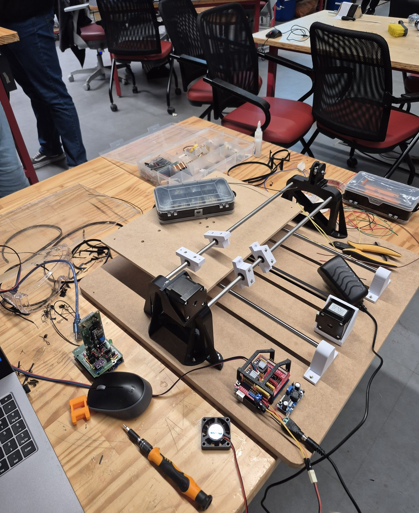

# InkHand

**A CNC pen plotter that writes in my own handwriting.**

I write the alphabet by hand, turn each letter into single-line vectors, and a C++ program assembles any text, adds small natural variations so no two letters look the same, and generates G-code for the plotter.

> 🚧 **Status:** electronics bench test done and the pen servo working on its LM2596; the machine drawn in Fusion 360 and **assembled** (Nov 2026): the base and the bed machined on a CNC router, the Y axis with the bed, its belt, the belt clamp and a tension spring, the 3 mm acrylic writing sheet cut on a laser cutter, and the gantry with the 2 uprights, the X rods, the carriage's bearing blocks, the X motor and the X idler, with the parts printed on Bambu Lab printers. The X belt clamp and a box for the fan are printed, and the support of the pen lift (Z) is drawn and printing: a frame on the X carriage with 2 vertical rods, for a pen carriage moved by the servo. Next: assemble it all again, the X carriage plate and the X belt, the pen carriage, the wiring (being redone), then the first moves.


<!-- Replace with a GIF of the plotter writing when it works -->

## How it works

```
Machine:   Fusion 360 → FabLab (laser + 3D print) → assembly → electronics → GRBL + servo → calibration
Handwriting: template sheet ×4 → handwriting → 600 dpi scan → Inkscape centerline trace → inkhand import → glyphs
Writing:   letter.txt → inkhand write → letter.gcode → UGS → Arduino (GRBL) → paper
```

## Hardware

| Part | Choice |
|---|---|
| Controller | Arduino UNO + CNC Shield V3 |
| Drivers | 2 × DRV8825, 1/32 microstepping, 1.0 A (Vref 0.50 V) |
| Motors | 2 × NEMA 17 (17HS4401S) |
| Motion | Cartesian: fixed gantry in X, moving bed in Y, GT2 belt, 20-tooth pulleys (5 mm bore) |
| Linear motion | 4 × Ø8 × 400 mm steel rods, LM8SUU bearings (2 per rod) in split bearing blocks. X rods side by side with the pen between them |
| Resolution | 160 steps/mm (0.006 mm per step) |
| Pen lift | Tower Pro MG90S servo on Z+ (D11), powered by an LM2596 step-down at 5 V |
| Power | 12 V 5 A |

Full bill of materials: [hardware/bom.md](hardware/bom.md)

## Firmware

GRBL 1.1f with servo support (grbl-servo fork), sent from Universal G-code Sender (UGS). See [firmware/](firmware/).

## Software (planned)

C++20, Visual Studio. One executable, three commands:

```
inkhand import  data/sheets/variant1.svg 1     # sheet SVG → glyph files
inkhand write   samples/letter.txt out/letter.gcode
inkhand template out/template_sheet.svg        # printable handwriting template
```

## Repository layout

```
InkHand/
├─ InkHand.slnx      Visual Studio solution
├─ InkHand/          C++ source (app/, domain/, input/, layout/, output/, external/)
├─ data/             config, sheet layout, demo glyphs (my real glyphs stay private)
├─ samples/          example .txt files
├─ firmware/         GRBL settings and flashing notes
├─ hardware/         BOM, wiring, Fusion 360 exports (F3Z, STEP, DXF, STL)
└─ docs/             lab journal, photos, README images
```

## Lab journal

Every work session is recorded by hand in a lab notebook and transcribed to [docs/journal/](docs/journal/).

## License

Code: MIT ([LICENSE](LICENSE)). Hardware files: CERN-OHL-P (to be added with the first CAD release).
