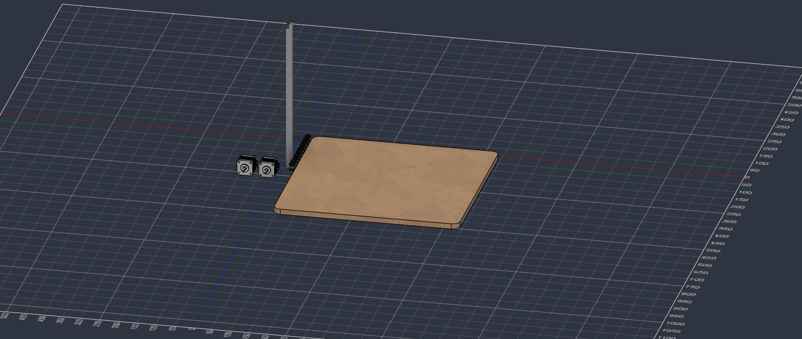

# 2026-10-10 · Session 3 · Repository and first Fusion 360 parts

Notebook page 4.

## Goals
- [x] Create the repository
- [x] Add the files
- [ ] Fix the P4 (DC barrel) power connector so it sits firmly
- [x] Draw the basic parts in Fusion 360

## Done
- Created the repository on GitHub and added the basic files (README, license, .gitignore, journal, firmware and hardware notes).
- First parts modelled in Fusion 360:
  - 10 × LM8UU linear bearings
  - 4 × rods
  - Base
  - 2 × NEMA 17

STEP export: [hardware/cad/Plotter_Pen_InkHand.step](../../hardware/cad/Plotter_Pen_InkHand.step)

## Pending
- Fix the P4 power connector.

## Tools
- Fusion 360
- GitHub
