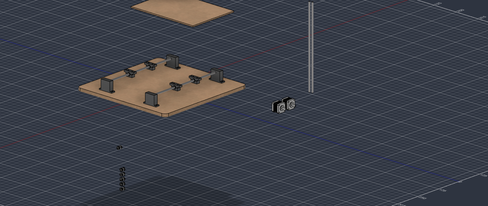
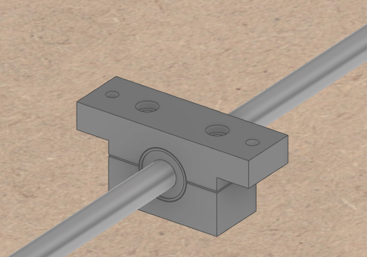

# 2026-10-11 · Session 4 · Frame design and Y axis in Fusion 360

Notebook pages 5–6.

*Goals, Done and Pending are transcribed from the notebook. The other sections add the day's design discussion and what the Fusion 360 model shows.*

## Goals
- [x] Define how the plotter will be put together
- [x] Research existing plotter designs
- [x] Research pulley and belt systems
- [x] Draw the basics of what was decided in Fusion 360

## Done
- Of the frames available, the best is a **fixed bridge (gantry) in X with a moving bed in Y**. Going with that one.
- Designed the bearing block for the lower axis (the bed). The model has 4 of them.
- Bought an M3 screw kit.
- Designed the rod supports.
- Put everything together in the Fusion 360 assembly.
- Defined what to do next.

## Decisions and why
- **Fixed gantry in X, moving bed in Y.** It is the stiffest layout that can be built with 2 motors and 4 rods. The bridge that carries the pen never moves, only the carriage runs along it, and the bed is pulled by one belt in its centre, so it cannot rack. Also considered: moving gantry and CoreXY (both need a third motor or a drive shaft to keep the gantry square, and CoreXY needs 6–8 idlers), a cantilever arm like the AxiDraw (too flexible with 8 mm rods and MDF) and a polargraph (not precise enough for small letters).
- **The frame limits precision, not the motors.** At 0.006 mm per step, what matters is stiff gantry columns, a tight belt, X square to Y and the 15 mm base. Rod deflection was estimated below 0.1 mm.
- **A4 in landscape:** 297 mm along the gantry (X) and 210 mm in the direction the bed moves (Y). The 400 mm rods don't need cutting and the bed bearings can be far apart. The software rotates the coordinates, so the text still comes out upright on the page.
- **2 bearings per rod:** 4 on the bed, 4 on the X carriage and 2 spares. A third bearing on the same rod doesn't make the axis stiffer, because what counts is the distance between the two outer ones. With printed blocks and MDF it is also hard to align, and the axis binds.
- **3D printing for small, precise parts** (bearing blocks, motor and idler mounts, belt clamps, pen module) and **MDF for large flat parts** (base, gantry columns, bed). The FabLab CNC router drills rounder, straighter rod holes than the laser. Cut a test hole first to choose between 7.8 and 8.0 mm.
- **Bearing blocks are screwed to the bed, never glued.** The screws let each block settle so both rods run parallel, and a worn bearing can be swapped. To assemble: blocks loose on the bed, slide the bed end to end a few times, then tighten little by little in a cross pattern, checking that it still slides freely.
- **Y motor under the bed,** between the rods: pulley at the back, idler at the front, a closed GT2 belt loop between them, and a clamp under the centre of the bed that grips the top run of the belt.
- **Heights,** measured from the top of the base: Y rods at 39 mm and the underside of the bed at about 51 mm (51.5 in the model), so the bed passes over the Y motor (top at 48 mm). The design puts the X rods at 82 and 137 mm.
- **Writing surface:** the bearing blocks screw to the bed, and a separate writing sheet (acrylic or similar) goes on top of the bed. It will be fixed later with screws right at its edges, outside the writing area, so nothing sticks up under the paper. The sheet raises the paper by its own thickness (design v1 had the paper at 57 mm), so the gantry heights must account for it.

## Changes from the detailed design (v1)
Before modelling, every part was dimensioned in a detailed design (v1). Several parts changed while drawing them, and from now on the Fusion model is the reference.

| | Design v1 | Fusion model |
|---|---|---|
| Rod supports | 2 MDF plates 230 × 48 × 12 mm, the rods pass through | 4 separate blocks, one per rod end |
| Distance between the Y rods | 200 mm | 250 mm |
| Bearing block | 32 × 18 mm. The same 2 screws close the block and go through the bed | 54 × 17 mm with ears. 2 screws close the block and 2 others fix it to the bed |
| Bed | 320 × 230 × 6 mm | 350 × 250 × 6 mm |
| Writing surface | Paper on the bed (optional 3 mm sheet) | Writing sheet (acrylic or similar) screwed to the bed at its edges |

With separate screws, each block can be closed on its bearing before the bed goes on, and the bed can come off without opening the blocks.

## The model today
Measured on the STEP export. Heights are from the top of the base.

| Part | Qty | In the model |
|---|---|---|
| Base | 1 | MDF 500 × 500 × 15 mm, R20 corners, 8 × Ø3.4 holes for the rod supports |
| Rod support | 4 | T-shaped block 70 × 49 × 20 mm: a 50 mm wide upright on a 70 × 5 mm foot. Ø7.8 blind hole, 10 mm deep, for the rod end, centred at 39 mm. 2 × Ø3.4 holes in the foot, 60 mm apart, with Ø6 × 2 mm recesses on top |
| Y rod | 2 | Ø8 × 400 mm, 250 mm apart, centre at 39 mm, 380 mm free between the supports |
| Bearing block | 4 | Two halves around an LM8SUU, 17 mm long. Top face at 51.5 mm (details below) |
| Bed | 1 | 350 × 250 × 6 mm, drawn but not yet placed or drilled |
| Not placed yet | | 2 × NEMA 17, the 2 X rods, 6 × LM8SUU (4 for the X carriage, 2 spares) |

**Bearing block**
- Upper half (against the bed): 54 × 17 × 12 mm. A 34 mm wide centre holds the top of the bearing, with an ear 10 mm wide and 8 mm thick on each side.
- Lower half: 34 × 17 × 12.5 mm.
- 2 × M3 close the halves: Ø3.4 holes 11 mm from the centre, the head in a Ø6 × 2 mm counterbore on top, the nut in a hex pocket (5.7 mm across flats, 2.6 mm deep) under the lower half.
- 2 × M3 fix the block to the bed: Ø3.4 holes in the ears, 44 mm apart, with a nut in a hex pocket under each ear.
- 0.5 mm gap between the halves, so tightening the screws clamps the bearing.
- The half-bores follow the outside of the LM8SUU model: Ø15 with two narrow Ø14.3 ridges that sit in the bearing's grooves and stop it sliding out.

## Checks before printing the blocks
- The closing screws need about 23 mm from the counterbore to the bottom face, so use M3 × 25 (about 2 mm sticks out underneath). An M3 × 20 stops before the nut.
- The counterbores are 2 mm deep and the bed sits right on that face. A socket head (3 mm tall) would stick out 1 mm. A button head (1.65 mm) fits, or make the counterbores 3.2 mm deep.
- The bearing model is 17 mm long, but the real bearing measured 16 mm (2026-10-10). Check that the ridges line up with its grooves before printing all the blocks.

## Pending
- Refine the supports and add the nut pockets to them. *(In the model the bearing blocks already have hex pockets; the rod supports still have round Ø6 recesses.)*
- Holes in the bed (the writing table) for the bearing blocks: 2 per block, over the ear holes. The heads must end flush so the writing sheet lies flat.
- Writing sheet on top of the bed, screwed at its edges (later).
- Not drawn yet: Y motor mount, pulley, idler and belt clamp; the X gantry; the pen module.

## Sketch
Page 5 has a pencil sketch of the bed and its belt: the bed as a rectangle, a closed belt loop running across it between two pulleys (the dark blocks at each end), and two short lines sticking out of each long side.

## Fusion 360

CAD exports of this day, at commit 3e2a26e: [STEP](https://github.com/audreifilhorossato/InkHand/blob/3e2a26e/hardware/cad/Plotter_Pen_InkHand.step) · [Fusion 360 archive (.f3z)](https://github.com/audreifilhorossato/InkHand/blob/3e2a26e/hardware/cad/Plotter_Pen_InkHand.f3z). The files in `hardware/cad/` now hold the latest export.

## Next step
Finish the Y axis in Fusion 360: nut pockets in the supports, holes in the bed, then the Y motor, belt and clamp.
