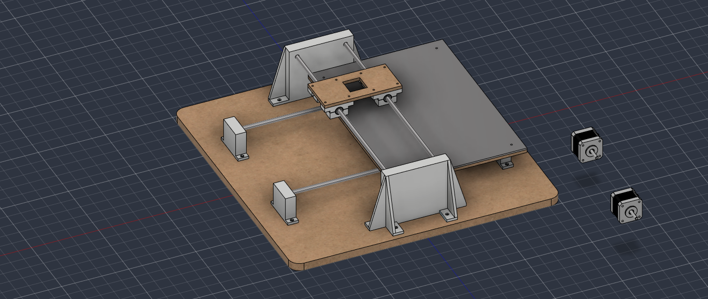
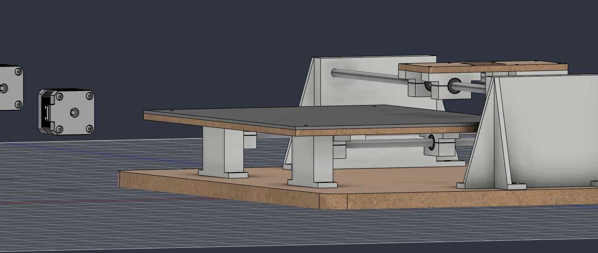

# 2026-10-12 · Session 5 · X gantry in Fusion 360, holes and joints fixed

Notebook page 7.

*Goals, Done and Pending are transcribed from the notebook. The other sections add what I said about the day and what the Fusion 360 model shows.*

## Goals
- [x] Get the writing table (the bed) working:
  - [x] Holes
  - [x] Joints
  - [x] Counter-table (the writing sheet on top of the bed)
- [x] Redo all the holes
- [ ] Fix the 3D printer bugs

## Done
- The LM2596 regulator and the servo arrived.
- The writing table (the bed) is OK.
- The upper carriage (X axis) is OK.
- Fixed the holes and the joints.
- Tried to fix the 3D printer, it didn't work.

## What changed in the model
Compared with the 2026-10-11 export:
- **Screw holes.** The rod supports got hex nut pockets (5.7 mm across flats, 2.6 mm deep) in place of the round Ø6 recesses, like the bearing blocks, and the base holes got Ø6 × 2 mm counterbores underneath for the screw heads. The holes on one side that were 0.15 mm off are now in line. The bed got its holes: 8 for the bearing blocks and 4 at the corners for the writing sheet.
- **Joints.** In the 2026-10-11 export the four bed blocks sat at different places along the rods (up to 8 mm out of line) and the bed floated above the machine. Now the blocks form a rectangle, the bed sits on them, and both axes move more smoothly in Fusion.
- **Writing sheet** (the counter-table). A 3 mm sheet the same size as the bed (350 × 250 mm), held by 4 M3 screws near the corners.
- **Y rods 206 mm apart** (250 mm on 2026-10-11). The rod supports and the base holes moved with them.
- **X gantry.** Two uprights screwed to the base, the two X rods side by side between them, and the X carriage: 4 bearing blocks (the same design as the bed's) under a plate with an opening for the pen in the middle.
- **Bearings.** 8 in the model (4 on the bed, 4 on the carriage). The 2 spares are no longer drawn.
- The 2 NEMA 17 motors are still not placed.

## Decisions and why
- **X rods side by side, with the pen in the middle.** The detailed design had the X rods one above the other, which leaves the pen 32 mm in front of them. Side by side:
  - the pen sits between the rods with no lever arm, so the friction of the pen on the paper can't twist the carriage;
  - the uprights are shorter (105 mm instead of 165), and shorter uprights flex less;
  - the carriage is a flat plate on 4 bearing blocks, the same way the bed is built.
- **Standard parts go in at the end.** Screws, nuts and the other standard parts will be imported into the Fusion model all at once when the design is finished. The screw list below is the starting point.

## Changes from the design
The detailed design was updated today for the rods side by side. The model follows it, with these differences:

| | Design | Fusion model |
|---|---|---|
| X rods | 90 mm apart, centre at 82 mm | 90 mm apart, centre at 91 mm |
| Gantry | 2 MDF columns about 100 mm tall, with a crossbar on top, behind the carriage | 2 uprights 105 mm tall with gussets, no crossbar |
| Carriage bearing blocks | 34 mm wide without ears, so the belt runs 20 mm behind the pen | 54 mm with ears, the same block as the bed |
| Carriage plate | 134 × 64 × 6 mm, Ø16 hole for the pen | 144 × 70 × 6 mm, 32 × 32 mm opening |
| Y rods | 200 mm apart | 206 mm apart |
| Bed bearings | 130 mm apart along the rod | 113 mm apart |

## The model today
Measured on the STEP export. Heights are from the top of the base.

| Part | Qty | In the model |
|---|---|---|
| Base | 1 | MDF 500 × 500 × 15 mm, R20 corners. 16 × Ø3.4 holes with Ø6 × 2 mm counterbores underneath: 8 for the rod supports, 8 for the uprights |
| Rod support | 4 | Same T-shaped block as on 2026-10-11, now with hex nut pockets in the foot |
| Y rod | 2 | Ø8 × 400 mm, 206 mm apart, centre at 39 mm, 380 mm free between the supports |
| Bed bearing block | 4 | Same block as on 2026-10-11, on a 113 × 206 mm rectangle. Top face at 51.5 mm |
| Bed | 1 | 350 × 250 × 6 mm, from 51.5 to 57.5 mm. 8 × Ø3.4 holes with Ø6 × 2 mm counterbores on top, over the ear holes of the blocks. 4 × Ø3.4 holes for the writing sheet |
| Writing sheet | 1 | 350 × 250 × 3 mm, from 57.5 to 60.5 mm (the writing surface). 4 × Ø3.4 holes 20 mm in from each edge, without countersink |
| Upright | 2 | 180 × 105 × 50 mm: a 120 × 105 × 20 mm wall with 4 triangular gussets (5 mm thick) and 4 feet (5 mm thick) with an M3 hole and a hex nut pocket. Ø7.8 × 10 mm blind holes for the X rods |
| X rod | 2 | Ø8 × 400 mm, side by side, 90 mm apart, centre at 91 mm, 380 mm free between the uprights |
| Carriage bearing block | 4 | Same block as the bed, 2 per rod, 53 mm between bearing centres |
| Carriage plate | 1 | 144 × 70 × 6 mm, from 103.5 to 109.5 mm. 32 × 32 mm pen opening in the middle, 8 × Ø3.4 holes over the ear holes of the blocks |
| Not placed yet | | 2 × NEMA 17 |

- **Travel:** 310 mm along the gantry (X) and 250 mm for the bed (Y). A4 in landscape (297 × 210 mm) fits.
- **Clearances:** 18 mm from the writing surface to the bottom of the carriage, 15 mm between the bed and each upright, 2.5 mm between the bed and the tops of the rod supports.
- **Writing sheet screws:** the heads stand on the writing surface, about 6.5 mm outside the corners of an A4 sheet centred on the bed and right at the end of the pen's travel along X, so the pen has to stay up there.

## Checks before building
The three checks from 2026-10-11 still apply, because the bearing block didn't change. New ones:
- **Screw heads under the writing sheet.** The 8 screws that hold the bed to the blocks sit in 2 mm counterbores on top of the bed, and the writing sheet lies on them. Use button heads (1.65 mm tall). A socket head (3 mm) would lift the sheet 1 mm. The same goes for the screws that close the blocks, under the bed and under the carriage plate.
- **Screw heads under the base.** The 16 counterbores under the base are also 2 mm deep, so socket heads would stick out 1 mm and the base would rock. Use button heads, or put rubber feet under the base.
- **Room for the X belt.** With the 54 mm blocks on the carriage there are 36 mm between the inner ears, and the pen opening takes 32 of them. The belt clamp no longer fits 20 mm behind the pen, as the design planned. Before drawing the X motor, choose one: run the belt outside the rods and clamp it to a tab on the plate, or use the 34 mm blocks without ears on the carriage.

## Screws
For importing into Fusion and checking against the kit. Each length is the shortest common size that goes all the way through the nut.

| Joint | Qty | Screw | Nut |
|---|---|---|---|
| Rod supports and uprights → base | 16 | M3 × 20, button head, from under the base | Hex pocket in the foot |
| Bearing block halves (bed and carriage) | 16 | M3 × 25, button head (2 mm sticks out underneath) | Hex pocket in the lower half |
| Bed → bearing blocks | 8 | M3 × 12, button head | Hex pocket under the ear |
| Carriage plate → bearing blocks | 8 | M3 × 14 | Hex pocket under the ear |
| Writing sheet → bed | 4 | M3 × 12 | Under the bed |
| **Total** | **52** | | **52 × M3** |

## Pending
- Fix the bugs and the timeline in Fusion 360.
- Add the motors and make their mounts.
- Test the servo and the regulator. *(Set the LM2596 to 5.0 V with nothing on its output, then connect the servo: see [firmware/](../../firmware/README.md#pen-servo-pending).)*
- Build the Z axis (pen lift).

Also still to do:
- Pulleys, idlers, belts and belt clamps for both axes.
- Route the cables.
- Import the screws, nuts and other standard parts into Fusion, all at once at the end.
- Fix the 3D printer.

## Fusion 360

CAD exports: [STEP](../../hardware/cad/Plotter_Pen_InkHand.step) · [Fusion 360 archive (.f3z)](../../hardware/cad/Plotter_Pen_InkHand.f3z)

## Next step
Motor mounts in Fusion 360: the Y motor under the bed and the X motor on one of the uprights. Then the belts, the pen lift (Z) and the servo test.
