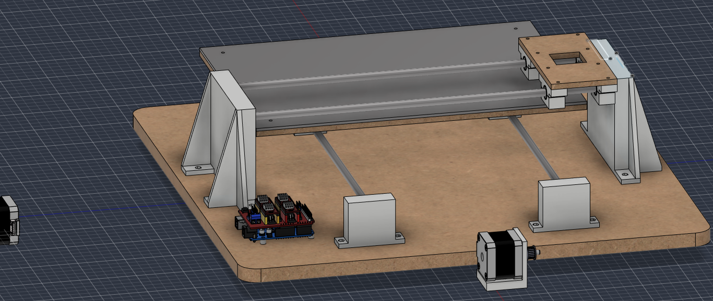
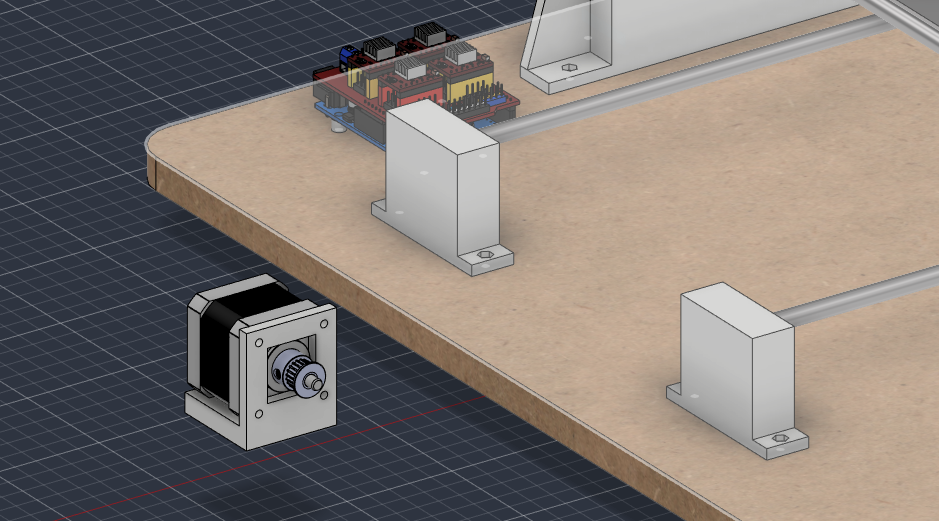

# 2026-10-13 to 2026-10-17 · Session 6 · Servo test, motor mounts and draft prints

No notebook pages.

*Nothing was written in the notebook in these five days, so they share one entry. It is built from what I said about the period, the questions I asked along the way, the photos and the Fusion 360 export of 2026-10-17.*

## Done
- **Servo and LM2596 tested.** The regulator and the servo worked. Details below.
- **Motor mount** designed in Fusion 360: an L bracket for the NEMA 17, in several versions. The first draft print was wrong, so I fixed it and printed it again.
- **Draft prints** of a bearing block, the rod supports and the motor mount, to check the fits before printing the final parts.
- **Rod holes Ø7.8 → Ø8.0.** At Ø7.8 the printed rod support was far too tight and the rod didn't go in at all. At Ø8.0 it was still tight, so I opened the hole with a drill.
- **Electronics in the model:** the Arduino UNO and the CNC Shield V3 (from GrabCAD) on the base, on 4 printed standoffs.
- **GT2 pulleys** (from GrabCAD) on both motors.

## Day by day
| Day | What I did |
|---|---|
| 2026-10-13 | First draft print, a bearing block, sliced in Bambu Studio. Looked up which GT2 pulleys to download from GrabCAD. Worked out the height of the Y motor and where the belt tensioner springs go. Looked up the Arduino UNO hole positions and imported the Arduino and the CNC Shield into Fusion 360. |
| 2026-10-14 | First try at the servo test: turning the LM2596 trimpot didn't change the output, so I stopped there. |
| 2026-10-16 | GT2 pulleys on the motor shafts. Last save of the model before the export (version 24). |
| 2026-10-17 | Servo test, this time working. Photos of the shield, the test wiring and the draft prints. New STEP and .f3z exports. |
| 2026-10-13 to 17 | Motor mount versions, rod holes changed to Ø8.0, draft prints of the rod supports and the motor mount. |

## Servo and LM2596 test
Wiring for the test (F008), connected with everything unplugged:
- 12 V from the supply comes in through a P4 (barrel jack) screw-terminal adapter and goes to both the shield's power terminal and the LM2596 input (IN+ and IN−).
- LM2596 OUT+ → servo red, OUT− → servo brown.
- Servo signal (yellow on this MG90S, orange in most diagrams) → the signal pin of **Z+** on the END STOPS header (D11). Z+ is the last pair on the right. One pin of the pair is the signal and the other is GND: the multimeter's continuity beep against the − screw of the power terminal tells which is GND.
- No jumper from OUT− to the Z+ GND pin for this test. The ground is already common through the supply: its V− goes to the shield and to IN−, and IN− and OUT− are joined inside the module. The jumper goes in later if the servo jitters.

Steps:
1. **LM2596 alone**, nothing on its output, multimeter on OUT: turn the trimpot to 5 V. On 2026-10-14 the reading didn't change. On 2026-10-17 it did after a few more turns: the trimpot is multi-turn and can take 10 to 20 turns before the voltage starts to move. The final reading wasn't written down.
2. **Servo connected**, loose on the table.
3. **UGS** (COM6, 115200), one command at a time, waiting for `ok`: `$30=255`, `$31=0`, `$32=0` (laser mode off: with it on, the servo only moves while the axes move). Then `M5`, `M3 S30`, `M5`, `M3 S60`, `M5`, `M3 S90`, `M5`, `M3 S120`, `M5`.

Result: the regulator and the servo worked. The angle for each S value wasn't written down, and the `$$` output wasn't saved, so [grbl_config.txt](../../firmware/grbl_config.txt) still lacks it.

The MG90S turns about 180° and knows its own position, so it needs no homing: it goes straight to the angle it is sent. The arm is fitted later, on the machine, after an `M5` (pen up).

## Draft prints
Printed in draft mode, only to check the fits (F007):
- **Bearing block**, both halves. The LM8SUU fits just right. This was the open check from 2026-10-11: the ridges in the half-bores follow the 17 mm bearing model, and the real bearing is 16 mm.
- **Rod supports.** At Ø7.8 the rod didn't go in at all. At Ø8.0 it was still tight and the hole had to be opened with a drill.
- **Motor mount**, 2 versions. The first was wrong and was fixed in the model before the second print.

## What changed in the model
Compared with the 2026-10-12 export (the Fusion design went from version 13 to version 24):
- **Rod holes Ø8.0** (were Ø7.8) in the 4 rod supports and the 2 uprights, after the draft print.
- **Counterbores 3 mm deep** (were 2 mm): the 16 under the base, the 8 on top of the bed and the 2 on each of the 8 bearing blocks. A socket head (3 mm tall) now ends flush. The 2026-10-11 checks suggested this, at 3.2 mm (see the checks below).
- **Motor mount** (Suporte_Motor): 2 identical L brackets, one per NEMA 17 (details below).
- **Arduino UNO + CNC Shield V3** from GrabCAD, on 4 printed standoffs (Suportes_eletrica), with 4 × Ø3.5 holes in the base at the official UNO hole positions. The board sits next to the feet of one upright, 20 mm from the edge of the base, with the USB and the power jack facing out.
- **GT2 pulleys** on both motor shafts.
- **Still outside the base:** the 2 motors and their mounts. One motor is in its mount; the other motor and the second mount are still apart.
- The bed and the X carriage are at another point of their travel, otherwise unchanged.

## The model today
Measured on the STEP export, new and changed parts only (the rest is as on [2026-10-12](2026-10-12.md#the-model-today)). Heights are from the top of the base.

| Part | Qty | In the model |
|---|---|---|
| Base | 1 | 16 × Ø3.4 holes with Ø6 × 3 mm counterbores underneath, plus 4 × Ø3.5 for the Arduino, without counterbores. No holes yet for the motor mounts |
| Rod support | 4 | Ø8.0 × 10 mm blind hole for the rod end |
| Upright | 2 | Ø8.0 × 10 mm blind holes for the X rods |
| Bed | 1 | The 8 counterbores on top are now Ø6 × 3 mm |
| Bearing block | 8 | The closing-screw counterbores are now Ø6 × 3 mm |
| Motor mount | 2 | L bracket, 43 mm wide, 51 mm tall and 43 mm deep. A 5 mm plate with a 23 × 24 mm window for the motor's centring boss and 4 × Ø3.4 holes on the NEMA 17 pattern (31 mm), and a 9 mm foot under the motor with 2 × Ø3.4 holes 21.5 mm apart and hex nut pockets on top. Motor axis 30 mm above the bottom of the foot |
| GT2 pulley | 2 | 20 teeth, 5 mm bore, Ø15 × 16 mm, on the motor shafts |
| Electronics standoff | 4 | Ø6 × 5 mm with a Ø3.5 hole, on the base |
| Arduino UNO + CNC Shield V3 | 1 | GrabCAD models, with 4 drivers and their heatsinks drawn. The top of the shield is 37 mm above the base |
| Not placed yet | | 2 × NEMA 17 with their mounts |

- **Clearance over the electronics:** near the end of its travel on that side, the edge of the bed passes over part of the board, about 14 mm above the top of the shield.

## Checks before building
- **Height of the Y motor.** The plan is to have the Y motor under the bed (2026-10-11). With the 9 mm foot its axis is at 30 mm and its top at 51 mm, only 0.5 mm under the bed (51.5 mm). The 2026-10-13 calculation puts the axis at 27 mm, which leaves about 3 mm: that means a 6 mm foot.
- **Screws of the mount's foot.** The 2 foot holes are under the motor, so the screw can't stick out of the top of the foot. From under the base, an M3 × 20 ends inside the nut (about 1.6 of its 2.4 mm) and an M3 × 25 would hit the motor. With a 6 mm foot only an M3 × 18 would fit. Moving the 2 holes out from under the motor (ears on the sides of the foot) removes this limit.
- **Arduino holes.** The 4 holes under the Arduino go straight through the base, without the Ø6 × 3 mm counterbores the other 16 holes have, so screw heads under the base would make it rock. Give them the same counterbores.
- **Ø8.0 still prints tight.** Printed holes come out smaller than drawn. Either keep Ø8.0 and open each rod hole with an 8 mm drill after printing, as I did, or try 8.2 mm on a test piece. The uprights have the same Ø8.0 holes.
- **3 mm counterbores leave no margin.** A socket head is 3 mm tall, so in a 3.0 mm counterbore it ends exactly flush, and a slightly shallow print or drilling leaves it proud under the writing sheet or the base. Make them 3.2 mm, as suggested on 2026-10-11, or keep the button heads.

## Screws for the new parts
The [2026-10-12 list](2026-10-12.md#screws) still works with the 3 mm counterbores: the screws just end 1 mm further past the nuts.

| Joint | Qty | Screw | Nut |
|---|---|---|---|
| NEMA 17 → motor mount | 8 | M3 × 8 | The motor's own threads |
| Motor mount → base | 4 | M3 × 20, from under the base (ends inside the nut, see the checks) | Hex pocket in the foot, under the motor |
| Arduino → base, through the standoffs | 4 | M3 × 25, from under the base | On top of the board, fitted before the shield |
| **Total** | **16** | | **8 × M3** |

The motor's threaded holes are usually 4.5 mm deep, so through the 5 mm plate an M3 × 10 can bottom out before it clamps the motor.

## Decisions and why
- **Y motor axis 24.5 mm under the bed**, 27 mm above the base, with the shaft level and pointing sideways. The motor is 42.3 mm tall, so its top stays about 3 mm under the bed. With the 20-tooth pulley (6.37 mm pitch radius) the top run of the belt is at about 33.4 mm, 18 mm under the bed, so the Y belt clamp under the bed is 18 mm tall and the idler at the other end goes at the same 27 mm. With the pulley, the idler and the clamp in one line, the belt runs parallel to the rods and its tension doesn't change along the travel.
- **Tensioner springs on the belts.** A belt is never perfectly tight, so I'll use the springs I have. A torsion spring that clips onto the belt goes on the return run, near the idler, not between the clamp and the pulley, so it doesn't stretch and relax at each change of direction (that would show up in the drawing as backlash). A spring that pushes the idler must be stiff, or the idler screw gets tightened after the spring sets the tension.
- **GT2 pulley: 20 teeth, 5 mm bore.** The bore fits the 5 mm shaft of the 17HS4401S (checked on the real pulley). The idler's bore (3 or 5 mm) is still to be measured.
- **Arduino holes from the official UNO drawing.** The 4 holes don't form a rectangle, so they can't be mirrored or patterned. The UNO is screwed down before the shield goes on, because the shield covers the holes.
- **Draft prints first.** Quick, coarse prints to test the fits, so a wrong part costs little. The final parts get printed once the holes are right.

## Pending
- Adjust the holes, including in the base: counterbores for the Arduino holes and holes for the 2 motor mounts.
- Place the motors: the Y motor under the bed with its axis at 27 mm, and a mount for the X motor on one of the uprights.
- Idlers (measure the bore first), belts and belt clamps for both axes.
- Pen lift (Z): servo and pen holder on the X carriage. Then find the S values for pen up and pen down, with the servo mounted.
- Save the `$$` output in [firmware/grbl_config.txt](../../firmware/grbl_config.txt).
- Final prints of the parts tested in draft.

Also still to do:
- Route the cables.
- Import the screws, nuts and other standard parts into Fusion, all at once at the end.
- Fix the 3D printer.

## Photos
| # | Photo |
|---|---|
| F006 | [CNC Shield V3 with the 2 DRV8825. Z+ is the last pair on the right of the END STOPS header](../photos/F006.jpg) |
| F007 | [Draft prints: 2 rod supports, 2 versions of the motor mount and a bearing block (both halves)](../photos/F007.jpg) |
| F008 | [Servo test wiring: barrel-jack adapter, LM2596, MG90S and the shield](../photos/F008.jpg) |

## Fusion 360

CAD exports of this period, at commit b1fb3a7: [STEP](https://github.com/audreifilhorossato/InkHand/blob/b1fb3a7/hardware/cad/Plotter_Pen_InkHand.step) · [Fusion 360 archive (.f3z)](https://github.com/audreifilhorossato/InkHand/blob/b1fb3a7/hardware/cad/Plotter_Pen_InkHand.f3z). The files in `hardware/cad/` now hold the latest export.

## Next step
Put the Y motor under the bed at the right height and drill the base for the motor mounts and the Arduino. Then the idlers, belts and clamps, and the pen lift (Z) with the servo on the carriage.
