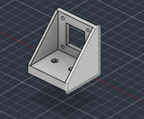
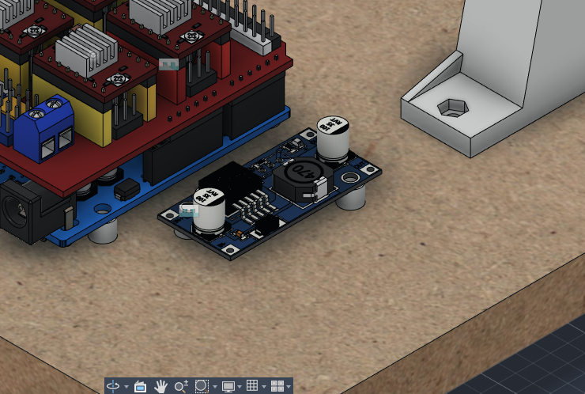

# 2026-10-19 · Session 7 · Deeper counterbores, LM2596 and servo in the model, Y motor placed

Notebook page 8.

*The notebook page only lists the goals. I worked on the model on the 19th and the 20th and couldn't tell afterwards which change was made on which day, so the split between this entry and [2026-10-20](2026-10-20.md) is a reconstruction. It follows the goals on this page, the dates the servo and LM2596 models were imported and the questions I asked on each day. The bearing blocks were printed half on each day. There is no export of the model from this day: the one from the evening of the 20th has all of these changes.*

## Goals
Transcribed from the notebook, all under "Fusion":
- [x] Adjust the room for the screw heads to 3.3 mm
- [x] Place the rest of the electronics *(the LM2596 is placed; the servo is in the model but not placed yet)*
- [x] Print the bearing blocks *(4 today, the other 4 on 2026-10-20)*
- [ ] Place the motors *(the Y motor is placed; the X motor still has no mount)*
- [x] Make the holes in the base in Fusion

## Done
- **Counterbores 3.0 → 3.3 mm** everywhere: under the base, on top of the bed and on the bearing blocks.
- **Arduino holes** got the same Ø6 × 3.3 mm counterbores as the others. This was a check on [2026-10-13 to 17](2026-10-13_to_2026-10-17.md#checks-before-building).
- **LM2596 and servo models** downloaded from GrabCAD (searched for `LM2596` and `MG90S`) and imported. The LM2596 is placed on the base next to the Arduino. The servo is only imported, outside the base.
- **Y motor placed** on the base in its mount, at one end of the Y rods.
- **Motor mount reinforced** with 2 triangular side gussets.
- **Holes in the base** for the motor mount and the LM2596.
- **Idler support started:** an empty `Suporte_Roldana` component, nothing drawn in it yet.
- **4 of the 8 bearing blocks printed**, the final ones this time, no longer draft. Settings in the [2026-10-20 entry](2026-10-20.md#print-settings).

## What changed in the model
Compared with the [2026-10-17 export](2026-10-13_to_2026-10-17.md#the-model-today):
- **Counterbores 3.3 mm deep** (were 3.0): the 16 under the base, the 8 on top of the bed and the 2 on each of the 8 bearing blocks. A socket head (3 mm tall) now sits 0.3 mm below the surface instead of exactly flush. The 2026-10-17 checks suggested 3.2 mm.
- **The 4 Arduino holes** now have Ø6 × 3.3 mm counterbores under the base, like the rest, so the screw heads don't make the base rock.
- **LM2596 module** (`LM2596_5V`, 43.5 × 21 mm board) on 2 new printed standoffs next to the Arduino, with 2 new Ø3.5 holes through the base, counterbored underneath.
- **MG90S servo** (`Assembly Micro Servo MG90S`) imported, still outside the base. It goes on the X carriage with the pen lift.
- **Y motor on the base.** The mount sits between the two rod supports at one end of the Y rods (the end next to the Arduino), with the shaft level and across the rods. Its 2 foot holes are drilled in the base, 21.5 mm apart, counterbored underneath.
- **Motor mount** 43 → 49 mm wide: 2 triangular gussets, 3 mm thick, one on each side, join the motor plate to the foot. Its volume went from 22.5 to 30.8 cm³ (+37%).
- **`Suporte_Roldana`**, the idler support, created but still empty.

## The model on this day
Measured on the 2026-10-20 export, only the parts changed on this day. Heights are from the top of the base.

| Part | Qty | In the model |
|---|---|---|
| Base | 1 | 24 holes, all with Ø6 × 3.3 mm counterbores underneath: 16 × Ø3.4 for the rod supports and the uprights, 2 × Ø3.4 for the Y motor mount, 4 × Ø3.5 for the Arduino and 2 × Ø3.5 for the LM2596 |
| Bed | 1 | The 8 counterbores on top are now Ø6 × 3.3 mm |
| Bearing block | 8 | The closing-screw counterbores are now Ø6 × 3.3 mm |
| Electronics standoff | 6 | Ø6 × 5 mm with a Ø3.5 hole: 4 under the Arduino, 2 under the LM2596 |
| LM2596 | 1 | 43.5 × 21 mm board, 9 mm tall with its parts, on the 2 standoffs. About 6 mm from the edge of the Arduino, 22 mm from the nearest rod support |
| Y motor mount | 1 | L bracket, 49 mm wide, 51 mm tall and 43 mm deep. Same 5 mm plate (23 × 24 mm window, 4 × Ø3.4 on the 31 mm NEMA 17 pattern) and 9 mm foot (2 × Ø3.4 holes 21.5 mm apart, under the motor, with hex nut pockets), plus 2 gussets 3 mm thick |
| Y motor + GT2 pulley | 1 | In the mount. Shaft axis 30 mm above the base, top of the motor at 51 mm. The pulley is about 4.5 mm off the centre line between the Y rods. 15.5 mm between the mount and the rod support next to it |
| MG90S servo | 1 | GrabCAD model, not placed yet |
| Idler support | 1 | Empty component |

## Decisions and why
- **Counterbores at 3.3 mm.** At 3.0 mm a socket head ends exactly flush and anything slightly shallow, in the print or in the drilling, leaves it proud under the writing sheet or the base. 0.3 mm of margin is enough and costs nothing.
- **Gussets on the motor mount.** The plate only held to the foot along one edge. With the belt pulling on the shaft, the plate would flex forward. The 2 side gussets turn the L into a box-like corner.

## Pending
See [2026-10-20](2026-10-20.md#pending): the list there covers both days.

## Next step
Make the uprights and the rod supports lighter before printing them, and print the other 4 bearing blocks.
