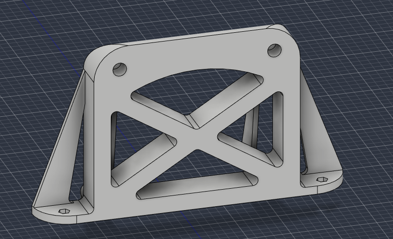
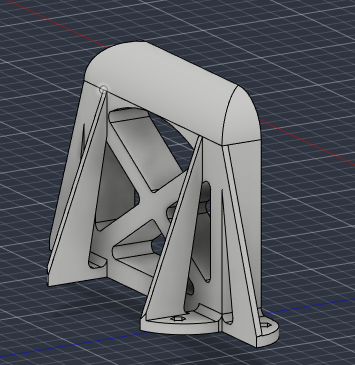
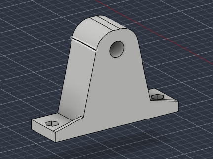
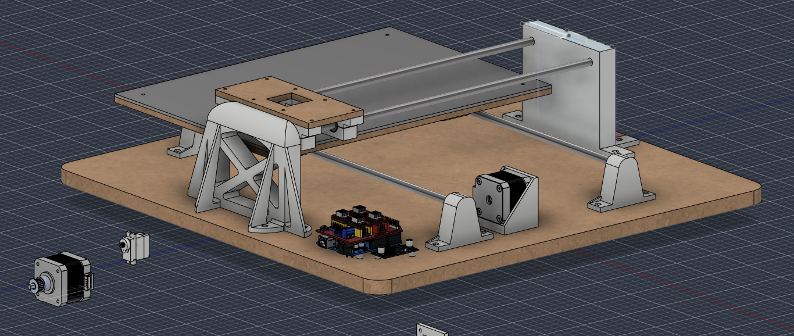

# 2026-10-20 · Session 8 · Lighter uprights and rod supports, final prints

No notebook page.

*Nothing was written in the notebook today. This entry is built from what I said about the two days, the questions I asked on the 20th about saving filament and the print settings, the photos and the Fusion 360 export of that evening (design version 34; the 2026-10-17 export was version 24). The split between this entry and [2026-10-19](2026-10-19.md) is a reconstruction.*

## Done
- **Rod supports redesigned** to use less material: rounder, with the body tapering up to a round top around the rod.
- **Uprights redesigned** (the supports of the X rods), also to save material: triangular openings in the gussets and X-shaped windows in the wall. Only one of the two is done: the mirrored copy still has to be mirrored again.
- **The other 4 bearing blocks printed.** All 8 are printed and assembled with their LM8SUU and closing screws (F009).
- **One rod support printed as a test.** It worked. The other 3 are still to print (F010).
- **New STEP and .f3z exports.**

## Saving filament
I asked how much material could come out of the uprights without making them weak. The answers, in short:
- The load goes from the rod holes at the top down to the feet. The gussets and the top of the wall carry it; the middle of the wall mostly just fills the space between them, so that is where material can go.
- **Triangles cut out of the gussets.** With the middle of each gusset open, the gusset becomes a truss: the wall, the foot and the sloped edge form a closed triangle, and a triangle doesn't deform. Keep the sloped edge at least 5 to 6 mm wide and round the inside corners.
- **X-shaped windows in the wall.** Two diagonals crossing in the middle leave four triangular windows. It is the lightest and the stiffest of the options I was given (one big window, two windows with a post in the middle, or the X), and the hardest to draw. Keep a frame of about 8 mm at the edges, at least 6 to 8 mm of material around each rod hole, and 3 mm fillets inside the windows.

The rod supports got the same idea in a simpler form: an A shape instead of a block.

## Print settings
Used for the 8 bearing blocks and the test rod support.

| Setting | Value |
|---|---|
| Printer | Bambu Lab X1 Carbon |
| Material | PLA |
| Nozzle | 0.4 mm |
| Layer height | 0.08 mm, for fine detail and a clean finish |
| Walls | 3 |
| Infill | 15%, 3D honeycomb |
| Top / bottom shell layers | 7 / 7 |
| X-Y hole compensation | 0, the default |

The suggestion when I asked was 0.20 mm layers, because a thin layer doesn't make a structural part stronger, only smoother and about 2.5 times slower, and 0.1 mm of hole compensation. I kept 0.08 mm for the finish and left the compensation at 0, and the test rod support came out right.

## What changed in the model
Compared with the end of [2026-10-19](2026-10-19.md#what-changed-in-the-model):
- **Rod supports** (all 4). Same envelope (70 × 20 × 49 mm) and the same feet, but the body is now an A: it tapers from 40 mm wide at the feet to a round top, R10 around the Ø8 rod hole (6 mm of wall around the rod). Volume 50.3 → 32.3 cm³ (−36%).
- **Upright** (one of the two). Same envelope (180 × 105 × 50 mm) and the same feet and holes. The 120 × 105 × 20 mm wall has four triangular windows between two diagonals about 9.6 mm wide, with 3 mm fillets, a 10 mm frame at the sides and a curved top edge. The 4 gussets went from 5 to 3 mm thick, each with a triangular opening. The top corners, one top edge and the corners of the feet are rounded. Volume 292.6 → 166.9 cm³ (−43%).
- **The mirrored upright** on the other side lost its gussets: it is now only the wall and the feet, with no windows (262.6 cm³). It has to be mirrored again from the new one.
- The bed and the X carriage are at another point of their travel, otherwise unchanged.

## The model today
Measured on the STEP export, parts changed on this day only. Heights are from the top of the base. The parts changed on the 19th are in [that entry](2026-10-19.md#the-model-on-this-day); the rest is as on [2026-10-13 to 17](2026-10-13_to_2026-10-17.md#the-model-today).

| Part | Qty | In the model |
|---|---|---|
| Rod support | 4 | 70 × 20 × 49 mm. 5 mm feet with an M3 hole and a hex nut pocket each. Body 40 mm wide at the feet, tapering to an R10 top. Ø8.0 × 10 mm blind hole, centre at 39 mm |
| Upright | 1 | 180 × 105 × 50 mm. Wall 120 × 105 × 20 mm with the X windows (from 10 to 85 mm above the base), 4 gussets 3 mm thick with triangular openings, 4 feet with an M3 hole and a hex nut pocket. Ø8.0 × 10 mm blind holes, centres at 91 mm |
| Upright (mirrored) | 1 | Broken mirror: wall and feet only, no gussets, no windows |
| Not placed yet | | The X motor (no mount yet) and the MG90S servo |

## Checks before building
- **Mirror the upright again** before printing the uprights. In the main screenshot below it is the plain plate at the back.
- **Height of the Y motor** (from [2026-10-13 to 17](2026-10-13_to_2026-10-17.md#checks-before-building)). The mount still has the 9 mm foot, so the top of the Y motor is at 51 mm, 0.5 mm under the bed (51.5 mm), and the bed passes over it near that end of its travel. A 6 mm foot brings the axis to 27 mm and leaves about 3 mm.
- **Screws of the mount's foot.** The 2 holes are still under the motor. With the 3.3 mm counterbores an M3 × 20 from under the base now reaches about 1.9 of the nut's 2.4 mm, and an M3 × 25 would still hit the motor. Ears on the sides of the foot would remove this limit.
- **The old motor mount is still in the model**, outside the base, without the gussets. The X motor needs its own mount anyway.
- **Thin top and bottom at 0.08 mm.** 7 layers of 0.08 mm make only 0.56 mm. For the bigger parts still to print, like the uprights, set the shells by thickness instead (about 0.8 mm top and 0.6 mm bottom) and the slicer works out the layers.
- **LM2596 holes.** The module's holes are about Ø3: check that an M3 goes through before printing anything around it.

## Screws for the new parts
The lists from [2026-10-12](2026-10-12.md#screws) and [2026-10-13 to 17](2026-10-13_to_2026-10-17.md#screws-for-the-new-parts) still hold: with the 3.3 mm counterbores each screw just sits 0.3 mm deeper.

| Joint | Qty | Screw | Nut |
|---|---|---|---|
| LM2596 → base, through the standoffs | 2 | M3 × 25, from under the base | On top of the board |

## Pending
For both days:
- Mirror the upright again.
- Print the remaining final parts: the other 3 rod supports, the 2 uprights and the motor mount.
- X motor: a mount (on one of the uprights) and its place in the model.
- Draw the idler support (`Suporte_Roldana`, created on the 19th but empty). Measure the idler bore first (3 or 5 mm). Then the belts and belt clamps for both axes.
- Pen lift (Z): place the servo on the X carriage with a pen holder, then find the S values for pen up and pen down.
- Save the `$$` output in [firmware/grbl_config.txt](../../firmware/grbl_config.txt).

Also still to do:
- Route the cables.
- Import the screws, nuts and other standard parts into Fusion, all at once at the end.
- Fix the 3D printer.

## Photos
| # | Photo |
|---|---|
| F009 | [The 8 bearing blocks, printed and assembled with their LM8SUU, and the test rod support](../photos/F009.jpg) |
| F010 | [The test rod support](../photos/F010.jpg) |

## Fusion 360

CAD exports: [STEP](../../hardware/cad/Plotter_Pen_InkHand.step) · [Fusion 360 archive (.f3z)](../../hardware/cad/Plotter_Pen_InkHand.f3z)

## Next step
Mirror the upright, print the other 3 rod supports and the uprights, then the X motor mount, the idler support and the belts.
