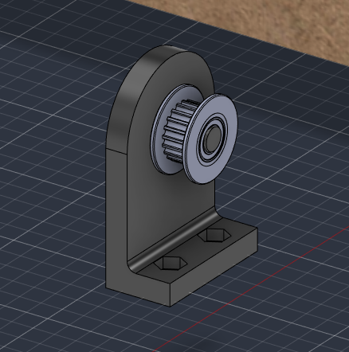
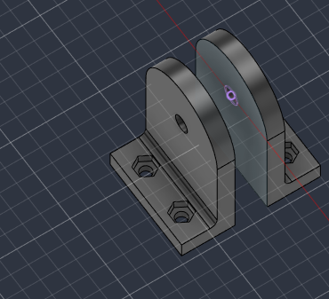

# 2026-10-22 · Session 9 · Idler support

No notebook page.

*Nothing was written in the notebook on the 22nd or the 23rd. This entry is built from what I said about the two days, the questions I asked on the 22nd about the idler support and the Fusion 360 export of the evening of the 24th (design version 38; the 2026-10-20 export was version 34). The split between this entry and [2026-10-23](2026-10-23.md) is a reconstruction.*

## Done
- **Idler support drawn** in Fusion 360. The `Suporte_Roldana` component, empty since the 19th, now has the support: first a plate with the idler on one side, then a fork with the idler between two tabs.
- **GT2 idler model** imported (`GT2_20T_kladka_dz`): 20 teeth, with bearings, 5 mm bore.
- **Idler support placed** on the base, at the end of the Y rods away from the Y motor, centred between the rods.
- **4 new holes in the base** for it, with the same Ø6 × 3.3 mm counterbores underneath as the others.
- **The other 3 rod supports printed**, with the same [settings as on 2026-10-20](2026-10-20.md#print-settings). All 4 are printed now.

## From a plate to a fork
The first version was an L: a foot with 2 screws and one upright plate, with the idler on one side of the plate.

I asked whether it was a good design. The answer was that the idea was right, because the belt pulls the idler in the plane of the plate, where the plate is stiffest. It listed these weak points:
- **The axle is held on one side only.** A tight GT2 belt pulls on the idler with about 40 to 80 N (both runs together). A screw held on one side bends and the plate twists, so with time the idler tilts and the belt walks to one side. A fork holds the axle on both sides.
- **The idler should turn on a bearing.** A toothed idler works only if the belt's teeth face it.
- **The belt has to run at the same height** on the idler and on the motor pulley. 1 mm off is enough for the belt to climb a flange.
- **The joint between the plate and the foot** needs a bigger fillet (3 to 5 mm) or a gusset at the sides.
- **No way to set the tension**, because the holes in the base are round. Slots 8 to 10 mm long would add one.

Then I redrew it as a fork and asked how to put an axle through it:
- **An M5 screw as the axle**, through both tabs, with the head on one side and the nut on the other. The idler turns on its own bearings and the screw stays still.
- **One hole through both tabs**, cut with a single *Extrude → Cut* so the two holes line up. 5.3 to 5.4 mm for an M5, because printed holes come out small; a 5 mm drill opens it if it's tight.
- **A hex pocket for the nut** on the outside of one tab (8.2 mm across flats, about 4 mm deep), so only the head needs a key.
- **Gap between the tabs:** the idler's width plus 2 washers plus about 0.5 mm. The washers should touch only the inner ring of the bearing, so tightening the screw clamps the inner ring and the fork stays stiff while the idler turns.
- **Join the two tabs** under or behind the idler, so they can't spread when the screw is tightened. The bridge must stay clear of the lower run of the belt.
- Standing up, as drawn, the fork prints fine. The top of the horizontal hole sags a little, and a drill cleans it.

## What changed in the model
Compared with the [2026-10-20 export](2026-10-20.md#what-changed-in-the-model):
- **Idler support** (`Suporte_Roldana`): a fork made of two mirrored halves (`Parte1` and its mirror). Each half is a tab 5 mm thick with a round top, standing on its own foot. The tabs are 9 mm apart. Three Ø5 pins join them, one above the idler and two below it. There is a Ø5.3 hole through both tabs for the M5 axle.
- **GT2 idler** between the tabs, its axis 30 mm above the base, the same height as the axis of the Y motor's pulley.
- **Base:** 4 new Ø3.4 holes with Ø6 × 3.3 mm counterbores underneath, on a 15 × 29 mm rectangle, for the feet of the idler support. 28 holes in total.

## The model on this day
Measured on the 2026-10-24 export, only the parts changed on this day. Heights are from the top of the base.

| Part | Qty | In the model |
|---|---|---|
| Idler support | 1 | Fork 30 × 45 × 39 mm (along the belt × height × across). 2 tabs 30 mm wide and 5 mm thick with an R15 round top, 9.0 mm apart, each on its own foot (30 × 15 × 5 mm) with 2 M3 holes 15 mm apart and hex nut pockets. Ø5.3 hole for the M5 axle, 30 mm above the base. 3 Ø5 pins between the tabs: one over the idler and two under it, with their centres 42.5 and 7 mm above the base. R2 fillet between each tab and its foot. 15.5 cm³ |
| GT2 idler | 1 | 20 teeth, Ø18 flanges, 8.5 mm wide (0.25 mm of clearance on each side between the tabs), 5 mm bore, with bearings. Axis 30 mm above the base |
| Base | 1 | 28 holes, all with Ø6 × 3.3 mm counterbores underneath: the 24 of 2026-10-19 and 4 new ones for the idler support |

- **Where it sits:** at the end of the Y rods opposite the motor, centred between them, in line with the rod supports at that end. The axes of the idler and of the motor pulley are 368.5 mm apart.
- **Clearance around the belt:** the pin above the idler is about 3 mm over the back of the belt, so it also keeps the belt from jumping off. The 2 lower pins are about 14 mm under the lower run.

## Decisions and why
- **A fork instead of a plate.** The axle is held on both sides, so the belt's pull can't bend it or twist the support, and the idler stays square to the belt.
- **The pins instead of a solid bridge.** They join the two tabs above and below the idler, so the tabs can't spread when the axle is tightened, and they stay out of the belt's way.
- **The idler at the same height as the motor pulley.** Both have 20 teeth and their axes are 30 mm above the base, so the two runs of the belt are parallel to the base. See the [belt line on the 23rd](2026-10-23.md#belt-line) for the clamp under the bed.
- **Round holes, no slots.** The tension comes from the springs on the return run of the belt ([2026-10-13 to 17](2026-10-13_to_2026-10-17.md#decisions-and-why)).

## Pending
See [2026-10-23](2026-10-23.md#pending): the list there covers both days.

## Next step
Machine the base on the CNC, print the idler supports and the motor mount, and start assembling the Y axis.
