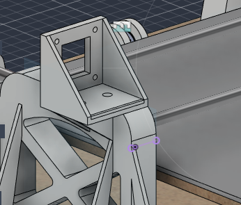
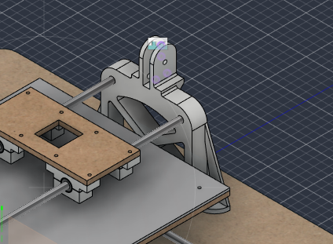
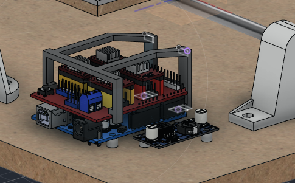

# 2026-10-26 · Session 11 · Uprights for the X motor and the X idler, fan support

No notebook page.

*Nothing was written in the notebook on the 26th or the 27th. This entry is built from what I said about the two days, the Fusion 360 screenshots, the photos of the 27th and the Fusion 360 export of the evening of the 28th (design version 44; the 2026-10-24 export was version 38). The split between this entry and [2026-10-27](2026-10-27.md) is a reconstruction. The work of the 28th (assembly) is not in either entry.*

## Done
- **Both uprights redrawn** in Fusion 360. They are two parts now, no longer one part and its mirror: one carries the X motor and the other the X idler.
- **X motor upright.** The motor plate is now part of the upright, on top of it, so the upright and the motor seat print as one piece.
- **X idler upright.** A fork for the X idler on top of it, like the [Y idler support](2026-10-22.md#from-a-plate-to-a-fork).
- **Idler axle lined up with the motor shaft.** I moved the hole of the idler axle until it was at the same height as the motor shaft, so the X belt runs parallel to the rods (the [belt line](2026-10-23.md#belt-line) again).
- **Fan support drawn**: a small frame over the Arduino and the CNC Shield, for the 40 mm fan that blows on the drivers. It has no holes for the fan yet; for now I'll drill them by hand. Maybe later I'll draw them in the model.
- **First upright printed overnight, and the print failed.** I think the power went out during the night. The part came out crooked (F020, F021, on the [27th](2026-10-27.md)).

## What changed in the model
Compared with [2026-10-23](2026-10-23.md#what-changed-in-the-model):
- **Uprights.** The old upright (`Suportes_Altos`, 170.9 cm³) and the small block on top of it are gone. In their place:
  - `Suporte_alto_mptpr`, the **X motor upright**, 196.5 cm³. Same foot, the same 4 screw holes in the base, the same rod holes and the same X windows as before, with the motor plate on top.
  - `Suporte_alto_mptpr(Mirror)`, the **X idler upright**, 187.5 cm³. The mirror of the motor upright, with the motor plate replaced by a fork for the idler.
- **X motor.** The motor plate moved from the separate mount into the motor upright. The separate mount (`Suporte (2) (1)`) is still in the model, now seated on the upright exactly where the plate is (same holes), so it overlaps the upright. The X motor itself is still outside the base, not placed yet.
- **Fan support** (`Suporte Fan`), new, 5.0 cm³.
- **A second idler support component** (`Suporte_Roldana (1)`), with no geometry in the export.
- The bed and the X carriage are at another point of their travel, otherwise unchanged.

## The model on this day
Measured on the STEP export of the 28th, parts changed on this day only. Heights are from the top of the base. The rest is as on [2026-10-23](2026-10-23.md#the-model-today) and the entries before it.

| Part | Qty | In the model |
|---|---|---|
| X motor upright | 1 | 180 mm wide, 50 mm deep foot, 152 mm tall at the motor plate. Foot, 4 × Ø3.4 base holes, Ø8 rod holes (axes 90 mm apart, 91 mm above the base) and X windows as on [2026-10-20](2026-10-20.md#the-model-today). On top: the flat seat 105 mm above the base and the 5 mm motor plate with the 4 × Ø3.4 holes on the 31 mm NEMA 17 pattern. **Motor shaft 131 mm above the base**, across the gantry. The motor body sits on the outer side of the plate and the shaft comes through the window towards the middle, where the idler is |
| X idler upright | 1 | Same foot, base holes, rod holes and windows, 150 mm tall at the fork. Fork: 2 tabs 5 mm thick, 9 mm apart, centred on the middle of the gantry (like the Y idler fork), R15 round top, 3 × Ø5 pins joining the tabs. **Idler axle hole Ø5.0, 131 mm above the base**, parallel to the motor shaft |
| Fan support | 1 | Frame of 3 mm bars, 59.5 × 61.2 mm, its top 40.6 mm above the base. At one end, 2 feet 3 mm thick sit on the Arduino board over 2 of its holes and take the same M3 screws as the standoffs underneath. At the other end, 2 hooks rest on the top of the CNC Shield, at its edges. No holes for the fan |
| X motor mount (separate) | 1 | Still in the model, now on the upright's seat, overlapping the plate. Not printed |
| Not placed yet | | The X motor with its pulley, the X idler and the MG90S servo |

- **X belt:** the motor shaft and the idler axle are 419.5 mm apart, both with 20 teeth, so the belt is about 880 mm around them, plus what goes into the clamp. Its lower run is at about 124.6 mm above the base, 15 mm above the X carriage plate (109.5 mm).

## Checks before building
- **The X belt runs over the pen.** The fork and the motor shaft are on the middle line of the gantry, so the lower run of the X belt passes right over the window of the carriage plate where the pen goes, 15 mm above the plate. The pen holder and the servo have to fit under it, or the pen has to move off the middle line. Decide this before drawing the pen lift (Z).
- **The X belt clamp** on the carriage has to reach the lower run, about 15 mm above the plate, the same way as the [Y clamp](2026-10-23.md#belt-line).
- **Sideways line-up of the X belt.** The X motor isn't placed yet, so the position of its pulley on the shaft can't be checked against the idler. Check it when the motor goes in, and slide the pulley on the shaft if needed (as on the Y axis).
- **Idler axle hole Ø5.0.** Printed holes come out small, so an M5 screw may not go in. Open it with a 5 mm drill, or draw it at 5.3 to 5.4 mm like the [Y fork](2026-10-22.md#from-a-plate-to-a-fork).
- **Clearance between the fan and the bed.** The bed passes over the electronics near one end of its travel. Its underside is 51.5 mm above the base and the top of the fan support 40.6 mm, so a 10 mm fan on top leaves about 1 mm. Screw heads on top of the fan wouldn't fit: put the screws in from the top with the heads under the frame, or use the fan's own holes with short screws that don't stick out.
- **The separate X motor mount** overlaps the upright now. Delete it or hide it, so it isn't counted or printed by mistake.

## Pending
For both days, see the [2026-10-27 entry](2026-10-27.md#pending).

## Fusion 360
CAD exports: [STEP](../../hardware/cad/Plotter_Pen_InkHand.step) · [Fusion 360 archive (.f3z)](../../hardware/cad/Plotter_Pen_InkHand.f3z)

## Next step
Print the two uprights again and mount the electronics on the base.
