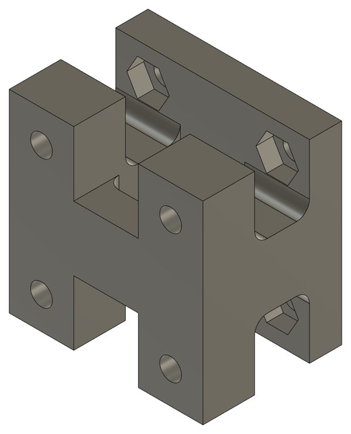

# 2026-11-05 · Session 13 · Belt support under the bed, holes in the bed, fan support v2

No notebook page.

*Nothing was written in the notebook on the 5th or the 6th. This entry is built from what I said about the two days, the files on my laptop with their dates (the parts exported for printing, the slicer project and the CNC program of the 5th) and the Fusion 360 export of the evening of the 6th (design version 51; the 2026-10-28 export was version 44). The split between this entry and [2026-11-06](2026-11-06.md) is a reconstruction. The assembly of Oct 28 and anything between Oct 29 and Nov 4 isn't recorded: there are no photos or notes of those days.*

## Done
- **Belt support drawn** (`Suporte_correia`), under the middle of the bed. It holds the two ends of the Y belt (the [belt clamp](2026-10-23.md#belt-line) planned on the 23rd). Exported for printing at 17:46 and printed in black PLA.
- **4 new holes in the bed** for the belt support, on a 20 × 20 mm square in the middle, with counterbores on top like the holes of the bearing blocks.
- **First CNC program for the bed** (`mesamovel.tap`, 17:38), in the Manufacture workspace of Fusion 360: the 16 holes, the 12 counterbores and the outline. It had two problems, fixed in the programs of the 6th (see [Machining the bed](2026-11-06.md#machining-the-bed-on-the-cnc)).
- **Fan support, second version.** The first one was weak and broke. Sliced at 18:29 and printed with stronger settings (below).

## Fan support v2
The first fan support ([2026-10-26](2026-10-26.md#what-changed-in-the-model)) is a frame of 3 mm bars, and it broke. Two changes:
- **Bigger hooks.** The 2 hooks that hold the far end of the frame on the CNC Shield got a 3 × 3 mm lip on the inside, so each is 6 mm wide at the tip instead of 3 mm, and they end 0.3 mm higher (5.02 → 5.10 cm³). The rest of the frame is the same.
- **Stronger print settings.** The first one was printed with 2 walls and 10% infill. The second one went back to my usual settings ([2026-10-20](2026-10-20.md#print-settings)):

| Setting | First (2026-10-27) | Second (2026-11-05) |
|---|---|---|
| Printer | Bambu Lab P2S | Bambu Lab P2S |
| Layer height | 0.08 mm | 0.08 mm |
| Walls | 2 | 3 |
| Infill | 10%, 3D honeycomb | 15%, 3D honeycomb |
| Top / bottom shell layers | 6 / 6 | 7 / 7 |
| Supports | On | On |

It broke again. The third version and the glue are on the [6th](2026-11-06.md#the-fan-support-broke-again).

## What changed in the model
Compared with [2026-10-27](2026-10-27.md#what-changed-in-the-model). There is only one export for the two days (the evening of the 6th), so what belongs to each day comes from the dates of the files:
- **Belt support** (`Suporte_correia`), new, 10.7 cm³.
- **Bed.** 4 new holes, Ø3.4 with Ø6 × 3.3 mm counterbores on top, for the belt support. They are already in the CNC program of the 5th.
- **Fan support.** Bigger hooks (above). The export of the 6th already has the third version.

## The model on this day
Measured on the STEP export of the 6th, parts changed on this day only. Heights are from the top of the base. The rest is as on [2026-10-26](2026-10-26.md#the-model-on-this-day) and the entries before it.

| Part | Qty | In the model |
|---|---|---|
| Belt support | 1 | 30 × 30 mm, 21.5 mm tall, hanging from the middle of the bed: from the underside of the bed (51.5 mm) down to **30.0 mm, the height of the pulley axes**. Three layers: a 5 mm plate under the bed; 2 posts 10 × 10 mm; and an H-shaped foot, 2 feet 10 mm long (along the belt) and 30 mm wide, joined in the middle by a bridge 10 mm wide. 4 × Ø3.4 holes on a 20 × 20 mm square go through the plate and the feet. Between the plate and the feet are open windows, where the screws pass and the nuts go into hex pockets (5.7 mm across the flats, 2.6 mm deep): 4 on the underside of the plate and 2 on top of each foot. Each end of the belt is pressed under one foot by a clamp plate (drawn on the [6th](2026-11-06.md#what-changed-in-the-model)). 10.7 cm³ |
| Bed | 1 | 250 × 350 × 6 mm MDF. 16 × Ø3.4 through holes: 4 near the corners for the writing sheet (20 mm from the edges), 8 for the bearing blocks and 4 for the belt support (20 × 20 mm square in the middle). The 12 last ones have Ø6 × 3.3 mm counterbores on top, so the screw heads stay under the writing sheet |
| Fan support | 1 | As on 2026-10-26, with a 3 × 3 mm lip on the inside of each hook (6 mm wide at the tip instead of 3 mm). 5.10 cm³ |

## Pending
For both days, see the [2026-11-06 entry](2026-11-06.md#pending).

## Fusion 360
CAD exports of the 6th: see the [2026-11-06 entry](2026-11-06.md#fusion-360).

## Next step
Cut the bed on the CNC, print the clamp plates and fit the Y belt.
