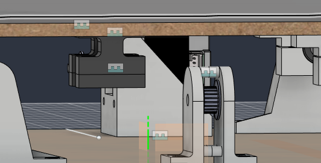
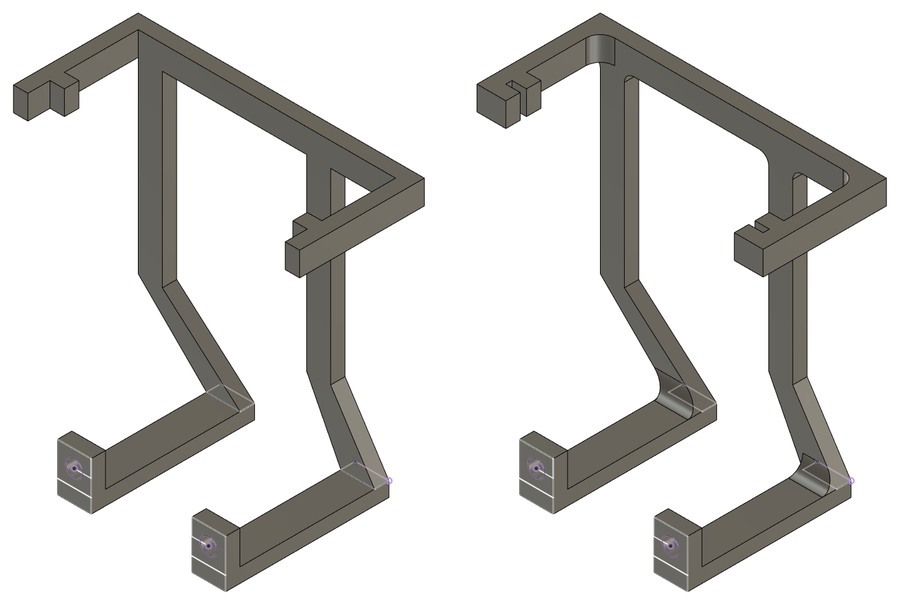
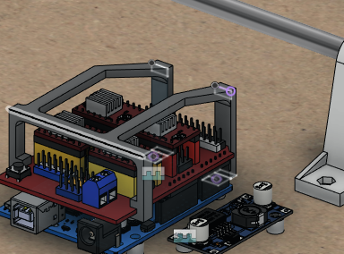
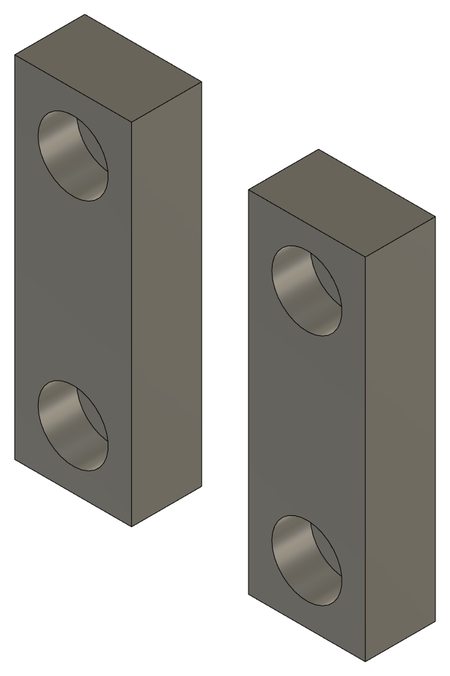
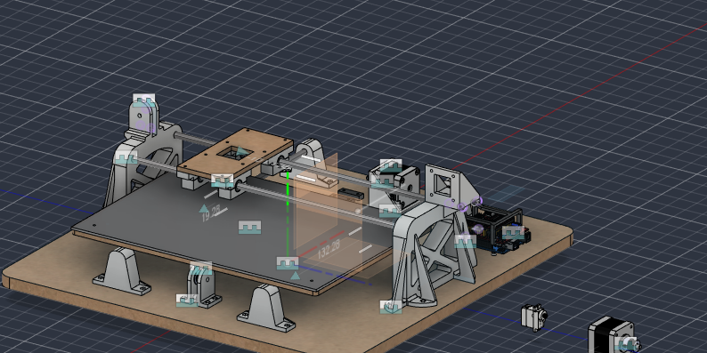

# 2026-11-06 · Session 14 · Bed cut on the CNC, Y belt fitted, the machine assembled

No notebook page.

*Nothing was written in the notebook on the 5th or the 6th. This entry is built from what I said about the two days, the photos and the videos of the day, the files on my laptop with their dates (the CNC programs, the parts exported for printing, the slicer job) and the Fusion 360 export of the evening of the 6th (design version 51). The split between this entry and [2026-11-05](2026-11-05.md) is a reconstruction.*

## Done
- **Bed corners rounded** in the model (R5), before cutting.
- **CAM for the bed redone** and **the bed cut on the lab's CNC router** out of 6 mm MDF (F022), with the setup done at the machine: the 16 holes, the 12 counterbores and the outline. Two short videos of the cut (not in the repository). There were problems on the way, solved below.
- **Clamp plates drawn** (`Encaixe`) and printed right after in black PLA (sliced at 15:46, 23 min, 3.1 g): 2 small plates that press the ends of the belt against the feet of the belt support.
- **Y belt fitted** (F023, F024): around the motor pulley and the idler, with both ends clamped under the belt support and a **tension spring** on one end, next to the clamp.
- **Bed screwed on its 4 bearing blocks**, with the belt support under its middle (F025, F030).
- **Fan support, third version** (exported at 10:30), with rounded inside corners. It broke again and is glued with super glue for now (below).
- **The whole machine assembled** (F027 to F029): the base, the Y axis with the bed and its belt, and the gantry: the 2 uprights screwed to the base, the 2 X rods, the 4 bearing blocks of the X carriage, the X motor on its plate and the X idler in its fork. Still missing: the top carriage (the X carriage plate), the X belt, the pen lift, the writing sheet and the wiring.
- **Electronics being redone** (F026). The first wiring was weak: I used poor cables. I'm redoing it now, and testing the fans.
- **New STEP and .f3z exports**, in the evening.

## Machining the bed on the CNC
The bed (250 × 350 × 6 mm MDF, R5 corners, 16 holes, 12 counterbores) was cut on the lab's CNC router, like the [base on the 23rd](2026-10-23.md#machining-the-base-on-the-cnc). The CAM was done in the Manufacture workspace of Fusion 360, with the Mach3 post processor (`.tap` files). Today the job was split into one program per tool:

| Program | Tool | What it cuts |
|---|---|---|
| `Audrei1.tap` | T2, Ø3.5 mm drill (120° tip), 10,000 rpm, 800 mm/min, 9 mm deep | The 16 through holes: 4 near the corners for the writing sheet, 8 for the bearing blocks, 4 for the belt support |
| `Audrei2.tap` | T4, Ø3 mm flat end mill, 10,000 rpm, 1,149 mm/min, plunging at 800 mm/min | The 12 counterbores, Ø6 × 4.3 mm, as pockets with a helical entry. Then the outline, in 3 passes of 2 mm, with holding tabs 0.75 mm tall on the last pass |

- **Origin:** a corner of the bed itself, on the top face, work offset G54.
- **Program of the 5th** (`mesamovel.tap`): the same operations in one file, with an optional stop (M1) for the tool change, the origin 25 mm and 35 mm away from the corner of the bed, and the 2 problems below.

## Problems → fixes
- **The counterbores were coming out smaller than drawn.** It was an option in Fusion: the counterbore operation (a 2D pocket) had **Stock to Leave** on, so the end mill stopped 0.5 mm short of the walls and of the floor. In the program of the 5th the counterbores were Ø5 × 2.8 mm instead of Ø6 × 3.3 mm, too small for an M3 socket head (Ø5.5 mm). → With the option off, today's program cuts them at Ø6. They are also 4.3 mm deep, 1 mm deeper than in the model, which leaves more room for the screw heads under the writing sheet.
- **Work offset.** The program of the 5th selected its origin with `G59 P54` instead of `G54`, an extra work offset that has to be set separately on the machine. Most likely the work offset number in the setup was 54: Fusion counts the offsets from 1 (1 is G54, 6 is G59) and writes bigger numbers as `G59 P…`. → Today's programs use G54, with the origin on a corner of the bed.
- **The fan support broke again.** → Glued with super glue for now (below).
- **The belt support and the fan support are hard to fit.** Both ended up underneath something: the belt support under the bed, and the feet of the fan support on the Arduino, under the CNC Shield, so their screws are hard to reach. They work for now; I may have to rethink them.
- **The belt goes down to the clamp.** The belt support pulls the top run of the belt down a little, a slight negative angle. Not significant, but the belt should be as straight as possible. → Raise the clamp (below).

## The belt line again
On the [23rd](2026-10-23.md#belt-line) I worked out that the clamp has to sit on the belt line: the top of the motor pulley, the top of the idler and the face of the clamp where the belt's teeth sit, all at about 36.4 mm above the base, about 15 mm under the bed.

The belt support reaches 21.5 mm under the bed. Its feet, where the belt is clamped, are at **30.0 mm above the base: the height of the pulley axes, about 6 mm under the belt line**. So the top run goes down from each pulley to the clamp. That's the negative angle I saw.

Same sums as on the 23rd, with 6 mm of difference. The bed travels about 250 mm (±125 mm), so at the ends of the travel the clamp comes to about 43 mm from the motor pulley and 45 mm from the idler:

| Distance from the clamp to the pulley | Angle of the belt | Belt longer than the straight distance by |
|---|---|---|
| 43 mm (end of the travel) | 8° | 0.41 mm |
| 170 mm (middle of the travel) | 2° | 0.11 mm |
| 290 mm (other end) | 1° | 0.06 mm |

The difference, about 0.35 mm along the travel, changes with the position, so calibrating the steps/mm can't remove it. Part of the pull of the belt also goes down onto the bed. It's small for letters a few millimetres tall, but worth fixing.

**Fix:** raise the clamp face by about 6 mm, to about 36 mm above the base, by making the support about 15.5 mm tall instead of 21.5 mm (shorter posts). Before reprinting, measure on the machine the height of the top run at the motor pulley and right next to the clamp. Shims between the bed and the support can't help here: they would lower it more.

## The fan support broke again
The second fan support ([2026-11-05](2026-11-05.md#fan-support-v2)) broke too. In the morning I drew a third version, with **rounded inside corners**: R2 fillets at the inside corners of the top frame, at the end with the hooks, and R3 fillets where the hooks and the legs hang from the frame (5.10 → 5.15 cm³). It broke again, so for now it is glued with super glue.

Next, I'll redraw it to be stronger, and easier to fit, because fitting it was very awkward. The fan isn't fixed on it yet: it is right at the height limit under the bed (about 1 mm, see the [checks of the 26th](2026-10-26.md#checks-before-building)), so I'll probably glue it to the support, or make a snap-fit for it.

## What changed in the model
Compared with [2026-11-05](2026-11-05.md#what-changed-in-the-model):
- **Bed.** R5 corners (they are square in the program of the 5th).
- **Clamp plates** (`Encaixe`), new: 2 bodies, 1.56 cm³ each. In the model they aren't joined to the bed, so they stayed where they were drawn and the bed has moved on: in this export they are about 200 mm from the belt support.
- **Fan support.** Third version, with the fillets (above).
- **CNC setup for the bed**, in the same file. Fusion marks the toolpaths as out of date, because the model changed after them.
- The bed, the writing sheet and the bed bearing blocks are at another point of their travel, otherwise unchanged. The rest of the model is as on 2026-10-28.

## The model today
Measured on the STEP export of this evening, parts changed on this day only. Heights are from the top of the base. The belt support and the bed holes are in the [2026-11-05 entry](2026-11-05.md#the-model-on-this-day).

| Part | Qty | In the model |
|---|---|---|
| Clamp plate | 2 | 10 × 30 × 6 mm, the size of one foot of the belt support. 2 × Ø3.4 holes 20 mm apart, the same holes as the foot, with Ø6 × 3.3 mm counterbores underneath. Each one presses one end of the belt against a foot. Fitted, its underside is 24.0 mm above the base, minus the thickness of the belt. 1.56 cm³ |
| Bed | 1 | As on the 5th, with R5 corners |
| Fan support | 1 | As on the 5th, with R2 fillets at the 4 inside corners of the top frame at the hook end, and R3 fillets where the 2 hooks and the 2 legs meet the frame. 5.15 cm³ |

- **Y belt:** the motor pulley and the idler both have 20 teeth, their axes 30 mm above the base and 368.5 mm apart. The top run leaves the pulleys at about 36.1 to 36.4 mm and goes down to the clamp at 30.0 mm. The lower run passes at about 23.3 to 24.7 mm (from the back of the belt to the tips of its teeth).

## Checks on the machine
- **Height of the clamp:** 6 mm under the belt line in the model (above). Measure it on the machine, then shorten the belt support.
- **The lower run under the clamp plates.** The lower run of the belt passes right under the clamp plates: 23.3 to 24.7 mm above the base, against 24.0 mm for the underside of the plates, which sit about 1.4 mm lower still once the belt is clamped between them and the feet. Check that the lower run doesn't rub on the plates or on the screw heads as the bed moves. Raising the clamp by 6 mm also clears it.
- **Clearance between the fan and the bed:** about 1 mm with a 10 mm fan on top of the support. No screw heads on top: glue the fan, or hold it from the sides.
- **Join the clamp plates to the bed** in the model, so they move with it and any clash with the lower run shows up when the bed moves.
- **Writing sheet:** still 250 × 350 × 3 mm with square corners in the model. Round its corners to R5 like the bed. Its 4 holes, 20 mm from the edges, line up with the 4 corner holes of the bed.
- **Counterbores of the bed:** 4.3 mm deep as cut, 3.3 mm in the model. Change the model, or keep it in mind when cutting another bed.
- From before: the separate X motor mount still overlaps the plate of the motor upright, and `Suporte_Roldana (1)` is still empty.

## Screws for the new parts
From the model. The counterbores of the bed were cut 1 mm deeper than drawn, so the bed screws come out 1 mm further past their nuts, into the windows of the support.

| Joint | Qty | Screw | Nut |
|---|---|---|---|
| Bed → belt support | 4 | M3 × 8, from the top of the bed, the head in a counterbore | Hex pocket on the underside of the support's plate |
| Clamp plate → belt support | 4 | M3 × 14, from below, the head in the plate's counterbore, through the belt and the foot (M3 × 12 only just reaches through the nut) | Hex pocket on top of the foot |

## Pending
For both days:
- **Top carriage:** make the X carriage plate, with the pen holder, the servo (pen lift, Z) and the clamp for the X belt. Decide first where the pen goes, since the X belt runs over the middle of the carriage ([checks of the 26th](2026-10-26.md#checks-before-building)).
- **X belt:** fit it with its clamp and spring, and line it up sideways with the X motor pulley.
- **Writing sheet:** acrylic or 6 mm MDF? Not decided yet.
- **Electronics:** finish redoing the wiring with better cables, then connect the motors, the servo and the fan.
- **Fan:** finish testing it and fix it on the support (glue or a snap-fit), wired to the 12 V input. Then run a 20-minute drawing and check how warm the drivers get.
- **Fan support:** redraw it stronger and easier to fit.
- **Belt support:** make it about 6 mm shorter, and check the lower run of the belt under the clamp (above). Maybe rethink it so it's easier to fit.
- Save the `$$` output in [firmware/grbl_config.txt](../../firmware/grbl_config.txt).
- Fill the misplaced counterbores under the base, only for looks.

Also still to do:
- Route the cables.
- Import the screws, nuts and other standard parts into Fusion, all at once at the end.

## Photos
| # | Photo |
|---|---|
| F022 | [The CNC router cutting the outline of the bed out of the 6 mm MDF sheet. The 4 holes for the belt support are the square in the middle](../photos/F022.jpg) |
| F023 | [The Y belt fitted with the bed off: the Y motor, the belt with its clamp in the middle, the idler at the far end, the X rods with the carriage's bearing blocks resting on top, and 2 spare springs](../photos/F023.jpg) |
| F024 | [The belt support with its 2 clamp plates on the Y belt, and the tension spring on one end of the belt](../photos/F024.jpg) |
| F025 | [The bed after the CNC, top face: the 4 corner holes for the writing sheet, the 8 counterbored holes for the bearing blocks and the 4 for the belt support in the middle. The 40 mm fan on the left, not fitted yet](../photos/F025.jpg) |
| F026 | [The fan support on the CNC Shield, the LM2596 and the DC jack, while the wiring is being redone. Behind them, an upright with the X rods and the Y motor with the belt](../photos/F026.jpg) |
| F027 | [My bench at the lab in the afternoon, with the bed on the Y axis](../photos/F027.jpg) |
| F028 | [The machine assembled: the bed on the Y axis, the gantry with the X rods, the 4 bearing blocks of the carriage, the X motor and the X idler, the electronics in front and the 12 V supply on the base](../photos/F028.jpg) |
| F029 | [Along the bed: the X rods and the carriage's bearing blocks above it, the Y motor and the Y belt under it](../photos/F029.jpg) |
| F030 | [Under the bed: the belt support with the clamp and the Y belt, next to the idler support](../photos/F030.jpg) |

## Fusion 360

CAD exports of the evening of the 6th, at commit 3de4aa3: [STEP](https://github.com/audreifilhorossato/InkHand/blob/3de4aa3/hardware/cad/Plotter_Pen_InkHand.step) · [Fusion 360 archive (.f3z)](https://github.com/audreifilhorossato/InkHand/blob/3de4aa3/hardware/cad/Plotter_Pen_InkHand.f3z). The files in `hardware/cad/` now hold the latest export.

## Next step
Make the top carriage with the pen holder and the servo, fit the X belt and finish the wiring. Then the first moves on both axes.
