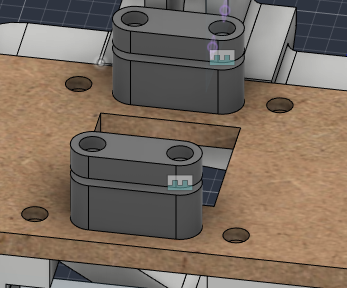
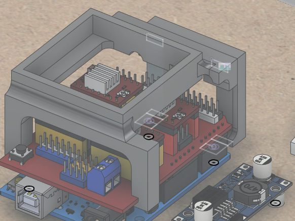
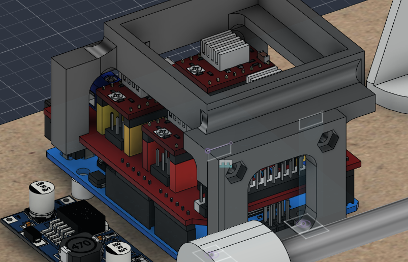
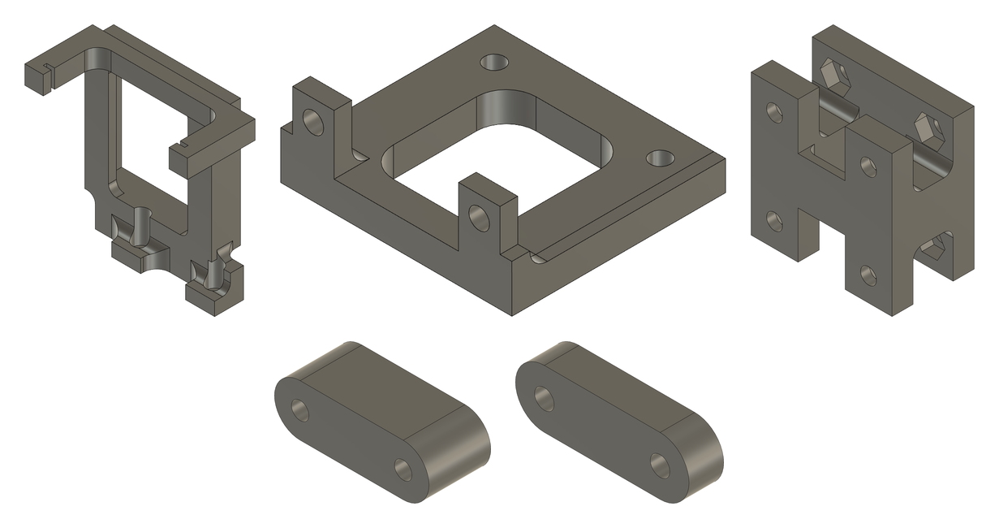
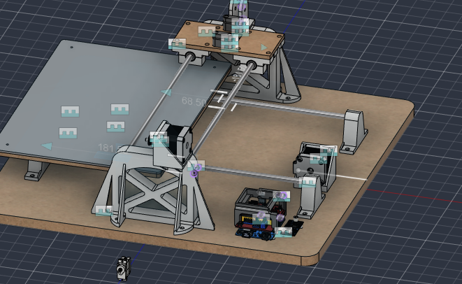

# 2026-11-10 · Session 15 · Writing sheet cut on the laser, fan box, X belt clamp, Y belt support shortened, pen lift chosen

No notebook page.

*Nothing was written in the notebook today. This entry is built from what I said about the day, four Fusion 360 screenshots taken at the end of the night, the files of the day (the laser file of the writing sheet, the parts exported for printing and the slicer project of the evening), the Fusion 360 export made just after midnight (design version 55; the export of the 6th was version 51) and the discussion about the pen lift (Z). There are no photos today: I had no time to take any, not even of the bench. Photos of everything assembled come in the next entry.*

## Done
- **Writing sheet cut on the laser cutter** out of 3 mm acrylic, and laid on top of the bed. Before cutting, I rounded its corners in Fusion (R5, like the bed). This settles the question left open on the [6th](2026-11-06.md#pending): the writing table is the 6 mm MDF bed with the 3 mm acrylic sheet on top.
- **Y belt support made 4 mm shorter** (21.5 → 17.5 mm), to bring the clamp up to the belt line. On the 6th the belt was pulled down a little at the clamp ([the belt line again](2026-11-06.md#the-belt-line-again)). I think it's level now; I'll test it tomorrow.
- **X belt clamp drawn** (what I call the upper belt support, `suportecorreiasuperior`): 2 blocks on the X carriage plate, one on each side of the pen opening, each with a clamp plate (`PRESILHA`) on top. It went together well in the model.
- **Holes of the X carriage plate fixed**: 4 new holes for the X belt clamp, and counterbores on top for the 8 screws of the bearing blocks. The plate still has to be cut on the CNC router.
- **Fan support redrawn as a box, in two parts** (`FAN1` and `FAN2`), in the evening. The fan is right at the height limit under the bed, so there's no room for screws on top of it: it goes inside the box, held by double-sided tape on its side. One part goes on the Arduino and the box fits onto it. Fitting the old support was very awkward; this one should be easy. It replaces the third version that broke and was glued.
- **All the new parts sent to print** in the evening, on one plate (below). I'll pick them up tomorrow and fit them.
- **Pen lift (Z) mechanism chosen** in its main lines (below).
- **New STEP and .f3z exports**, just after midnight.

## The writing sheet
- **3 mm acrylic, 250 × 350 mm, R5 corners**, with the 4 × Ø3.4 holes 20 mm from the edges that line up with the 4 corner holes of the bed. It is meant to be held by 4 screws through those holes.
- **Laser file:** [hardware/cad/writing-sheet.dxf](../../hardware/cad/writing-sheet.dxf), exported from Fusion (`mesamovel.dxf`): the outline and the 4 holes, in millimetres.
- **Height of the writing surface:** the bed is 51.5 to 57.5 mm above the base and the acrylic 57.5 to 60.5 mm, so **the paper lies at about 60.5 mm**. That is 43 mm under the underside of the X carriage plate (103.5 mm) and 49 mm under its top (109.5 mm). The pen lift has to reach that far down.

## Y belt support, 4 mm shorter
The support was cut down in the foot and the plate. The posts are the same:

| | 2026-11-06 | 2026-11-10 |
|---|---|---|
| Height | 21.5 mm | 17.5 mm |
| Plate under the bed | 5 mm | 4.5 mm |
| Posts (the windows) | 8.5 mm | 8.5 mm |
| Feet | 8 mm | 4.5 mm |
| Bridge between the feet | 5 mm | 1.5 mm |
| Plastic under the nut pockets | 2.4 mm in the plate, 5.4 mm in the feet | 1.9 mm in both |
| Underside of the feet (where the belt is clamped) | 30.0 mm above the base | **34.0 mm above the base** |
| Volume | 10.7 cm³ | 8.0 cm³ |

The 2 clamp plates (`Encaixe`) are now placed in the model, under the feet, 2 mm below them (the room for the belt), and they move with the bed.

**How close it is now.** On the pulleys, the back of a GT2 belt is 6.7 mm from the axis (20-tooth pulley), so the top run of the Y belt leaves the pulleys with its back at about 36.7 mm above the base. Under the feet, the back of the belt is pressed against them, at 34.0 mm. By the model, the clamp is still **about 2.7 mm under the belt line**, against about 6.7 mm on the 6th (the "about 6 mm" of that day, measured the same way). The same sums as on the [6th](2026-11-06.md#the-belt-line-again):

| Distance from the clamp to the pulley | Angle, 6th | Belt longer than straight, 6th | Angle, today | Belt longer than straight, today |
|---|---|---|---|---|
| 43 mm (end of the travel) | 8° | 0.41 mm | 3.6° | 0.08 mm |
| 170 mm (middle of the travel) | 2° | 0.11 mm | 0.9° | 0.02 mm |
| 290 mm (other end) | 1° | 0.06 mm | 0.5° | 0.01 mm |

The change along the travel drops from about 0.35 mm to about 0.07 mm. Tomorrow I'll measure it on the machine: the height of the top run at the motor pulley and right next to the clamp. If it still bends down, the posts can lose up to about 2.5 mm more. The plate and the feet are already thin.

**The lower run is clear of the clamp plates now.** Under the old support, the clamp plates would have come down to the lower run of the belt (23.3 to 24.7 mm above the base; a check of the [6th](2026-11-06.md#checks-on-the-machine)). Now their underside is at 26.0 mm, or about 26.6 mm once the belt is clamped: about 1.4 to 2 mm of clearance.

## X belt clamp
The X belt will be cut and its two ends clamped on the carriage, one at each end of the carriage plate. Between the two clamps, over the pen opening, only the top run of the belt passes.

| Part | Qty | In the model |
|---|---|---|
| Lower block (`Suportebaixo`, `Suportebaixo(Mirror)`) | 2 | 30 × 10 mm with round ends (R5), 12 mm tall, 2 × Ø3.4 through holes 20 mm apart, no nut pockets. Stands on the carriage plate, across it, one on each side of the pen opening, 51 mm apart centre to centre. 3.1 cm³ |
| Clamp plate (`PRESILHA`, `PRESILHA(Mirror)`) | 2 | The same outline, 6 mm thick, 2 × Ø3.4 holes with Ø6 × 3.3 mm counterbores on top. 2 mm over the block in the model: the room for the belt. 1.4 cm³ |

- The 4 screws go from the top, through the clamp plate, the belt, the block and the carriage plate, with the nuts under the plate, between the bearing blocks.
- The clamp is on the middle line of the gantry, like the X idler fork. The teeth of the X pulley are about 1.2 mm off that line, as on the Y axis.
- **Height:** the belt lies on the blocks at **121.5 mm** above the base. The X pulley and the idler axle are at 131 mm, so the lower run leaves them with its back at about 124.3 mm. The clamp is about **2.8 mm under the line of the lower run**, so the belt goes down to it. At the ends of the travel the clamps come to about 20 mm from the idler and 29 mm from the motor pulley, where 2.8 mm makes an angle of about 8° and 5°, and the belt about 0.2 and 0.13 mm longer than straight. In the middle it's 0.02 mm. See [checks](#checks-on-the-machine).

## X carriage plate
144 × 70 × 6 mm MDF, as before, with the 32 × 32 mm pen opening in the middle. Changes:
- The **8 holes for the bearing blocks** now have **Ø6 × 3.3 mm counterbores on top**, like the bed.
- **4 new Ø3.4 holes** for the X belt clamp: 2 pairs 20 mm apart across the plate, 51 mm apart along it, one pair on each side of the pen opening.

To cut on the CNC router, like the bed ([2026-11-06](2026-11-06.md#machining-the-bed-on-the-cnc)): with Stock to Leave off for the counterbores, and work offset G54.

## Fan box
The fan support broke twice ([2026-11-06](2026-11-06.md#the-fan-support-broke-again)) and was hard to fit, because its feet are on the Arduino, under the CNC Shield. The new one is a box for the fan, in 2 parts:

| Part | In the model |
|---|---|
| Box (`FAN1`) | 48 × 48 mm on top, with a 42 × 42 × 8 mm pocket for the 40 mm fan. The fan sits on a 3 mm floor with a 30 × 36 mm opening under it, which blows on the drivers. Its rim is 48.6 mm above the base. At the far end, 2 legs with hooks hold the edges of the CNC Shield, as in the old support. At the near end, a block with 2 screw holes joins it to the bracket. 14.9 cm³ |
| Bracket (`FAN2`) | An upright plate 39 × 36 × 5 mm across the end of the Arduino, with a 21 × 24 mm window (R5 corners) in the middle. At the bottom, 2 feet 3 mm thick sit on 2 of the Arduino's holes (Ø3.5, 27.9 mm apart: the same holes as the old support) and take the board's own screws. At the top, 2 hex nut pockets on the outside, for the 2 screws from the box. 4.8 cm³ |

- The fan is held by **double-sided tape on its side**, in the 1 mm gap between the fan and the wall of the pocket.
- The 2 screws that join the box to the bracket have their heads at the bottom of 2 bores that open into the fan pocket, so they go in before the fan.
- **Height:** the floor of the pocket is at 40.6 mm above the base, the same height as the top of the old support. A 10 mm fan on it still reaches 50.6 mm, about 0.9 mm under the bed, as before. The rim of the box is 2.9 mm under the bed.

## The print of the evening
All the new parts went on one plate: the box and the bracket of the fan, the shorter Y belt support, and the 2 blocks and 2 clamp plates of the X belt clamp. After the fan support broke twice, I used stronger settings than my usual ones:

| Setting | Usual ([2026-10-20](2026-10-20.md#print-settings)) | This plate |
|---|---|---|
| Printer | Bambu Lab X1 Carbon (P2S for the fan supports) | Bambu Lab A1 mini |
| Material | PLA | PLA (Bambu PLA Basic) |
| Nozzle | 0.4 mm | 0.4 mm |
| Layer height | 0.08 mm | 0.08 mm |
| Walls | 3 | **4** |
| Infill | 15%, 3D honeycomb | **20%**, 3D honeycomb |
| Top / bottom shell layers | 7 / 7 | 7 / 7 |
| X-Y hole compensation | 0 | 0 |

Also on this plate: supports on (normal, auto), a 20 mm brim on the outside and the inside of the parts, and the textured PEI plate.

## Pen lift (Z): the plan
I talked through the pen lift today, with sketches of the options. What I decided, in its main lines:
- **2 vertical metal rods**, with **small linear bearings** on a pen carriage that slides up and down on them. A few more parts will be adapted around them.
- **The servo only pushes the pen carriage up and down.** There is no fixed joint between the servo arm and the carriage: the arm just pushes it.
- **The pen is held by a small screw**, tightened enough to hold it firmly. Still being defined.
- **The pen goes in the middle of the carriage.** Before each writing session I'll set a zero for the machine, with the pen on the paper.

The options looked at:

| Mechanism | For | Against |
|---|---|---|
| Servo arm pushing the pen in a guide tube | Simplest, 1 part | The pen wobbles in the tube, and the pressure on the paper depends on where the servo stops |
| Pen holder on a lever with a pin | Simple | The tip moves on an arc, and any play shows in the line |
| **Pen carriage on 2 vertical rods** (chosen) | Stable: the pen only moves straight up and down | More parts |
| Mini linear rail (MGN7 or MGN9) | The most stable | Has to be bought |

Also discussed: a light spring that presses the carriage down, with the servo only lifting it. Then the pressure on the paper comes from the spring and stays the same, and the servo never pushes against the table. For now the plan is the servo pushing both ways.

**The pen and the X belt.** The top run of the X belt passes over the middle of the carriage, with its underside at about 136 mm above the base. With the paper at 60.5 mm, a pen in the middle can be at most about 75 mm long from the tip, or about 70 mm with the lift and a little clearance. A normal pen is about 140 mm. Ways out: a short pen or holder, the pen about 22 mm to the side of the belt, or the belt moved to the side. Still to solve, together with the drawing of the pen lift.

## What changed in the model
Compared with [2026-11-06](2026-11-06.md#what-changed-in-the-model) (design version 51 → 55):
- **Writing sheet:** R5 corners (above).
- **X carriage plate:** 8 counterbores and 4 new holes (above).
- **X belt clamp** (`suportecorreiasuperior`), new: 2 lower blocks and 2 clamp plates.
- **Y belt support:** 4 mm shorter (above).
- **Clamp plates of the Y belt** (`Encaixe`): placed under the belt support and moving with the bed. This was one of the checks of the 6th.
- **Fan support → fan box** (`Suporte Fan` now holds `FAN1` and `FAN2`).
- **X motor placed** on the plate of the motor upright, with its GT2 pulley: shaft 131 mm above the base, the same height as the X idler axle.
- **The separate X motor mount deleted.** It overlapped the motor upright since the 26th.
- The bed and the X carriage are at one end of their travel in this export: the bed at the idler end, the carriage against the idler upright.
- The rest is unchanged. Still not placed: the X idler, the fan and the MG90S servo. `Suporte_Roldana (1)` is still empty.

## Checks on the machine
- **Height of the Y clamp:** about 2.7 mm under the belt line in the model. Measure it tomorrow when the new support is on: the height of the top run at the motor pulley and next to the clamp.
- **Height of the X clamp:** about 2.8 mm under the lower run of the X belt in the model. The blocks are already printing, so check it when the X belt goes on. If the belt bends down at the clamps, print the blocks about 2.8 mm taller (14.8 mm), or put a 3 mm spacer under each block, with M3 × 30 screws.
- **Thin spots of the Y belt support:** 1.9 mm of plastic under the nut pockets and a 1.5 mm bridge between the feet. Don't overtighten the clamp screws.
- **Fan and bed:** about 0.9 mm between the top of a 10 mm fan and the bed, as before. Tape only on the side of the fan, never under it. Move the bed over the box by hand before running the motors.
- **Pen and X belt:** decide where the pen goes before drawing the pen lift (above).
- **Writing sheet:** check the 4 corner holes line up with the bed, then fit the 4 screws.
- From before: `Suporte_Roldana (1)` is still empty, and the bed's counterbores were cut 4.3 mm deep against 3.3 mm in the model.

## Screws for the new parts
From the model.

| Joint | Qty | Screw | Nut |
|---|---|---|---|
| X belt clamp → carriage plate | 4 | M3 × 25 from the top, the head in the clamp plate's counterbore, through the belt, the block and the plate. It only just comes through the nut | Under the plate, between the bearing blocks |
| Carriage plate → X bearing blocks | 8 | M3 × 12 from the top, the head in the new counterbores. The M3 × 14 still fit, but stick out about 3.3 mm under the ears, where there is room | Hex pocket under each ear |
| Y clamp plate → belt support | 4 | M3 × 12 from below. The M3 × 14 already fitted still fit, their tips about 1 mm from the bed screws above | Hex pocket on top of the foot |
| Bed → belt support | 4 | M3 × 8, unchanged | Hex pocket on the underside of the support's plate |
| Fan box → bracket | 2 | M3 × 8, the head inside the box, put in before the fan | Hex pocket on the outside of the bracket |
| Fan bracket → Arduino | 2 | The board's own M3 screws, through the feet | On top of each foot |

## Pending
- **Pick up the parts printed tonight and fit them:** the fan box and its bracket, the shorter Y belt support and the X belt clamp. Then check the Y belt (above).
- **X carriage plate:** cut it on the CNC router, with the new holes and counterbores, and fit it on the 4 bearing blocks.
- **X belt:** fit it with the new clamp and a spring, and check its height at the clamps.
- **Pen lift (Z):** draw it in Fusion (the 2 rods, the bearings, the pen carriage with the screw for the pen, the servo mount), after choosing the size of the rods and bearings and solving the pen and the X belt.
- **Writing sheet:** fix it with its 4 screws.
- **Electronics:** finish redoing the wiring with better cables, then connect the motors, the servo and the fan (on the 12 V input).
- **Photos** of the machine with everything fitted, and of the bench.
- Save the `$$` output in [firmware/grbl_config.txt](../../firmware/grbl_config.txt).
- Route the cables.
- Fill the misplaced counterbores under the base, only for looks.
- Import the screws, nuts and other standard parts into Fusion, all at once at the end.

## Photos
No photos today.

## Fusion 360
CAD exports of this day, at commit 8b36c08: [STEP](https://github.com/audreifilhorossato/InkHand/blob/8b36c08/hardware/cad/Plotter_Pen_InkHand.step) · [Fusion 360 archive (.f3z)](https://github.com/audreifilhorossato/InkHand/blob/8b36c08/hardware/cad/Plotter_Pen_InkHand.f3z) · [writing sheet for the laser (.dxf)](../../hardware/cad/writing-sheet.dxf). The files in `hardware/cad/` now hold the latest export.

## Next step
Fit the new parts and test the Y belt, cut the X carriage plate on the CNC and put the X belt on. Then draw the pen lift.
