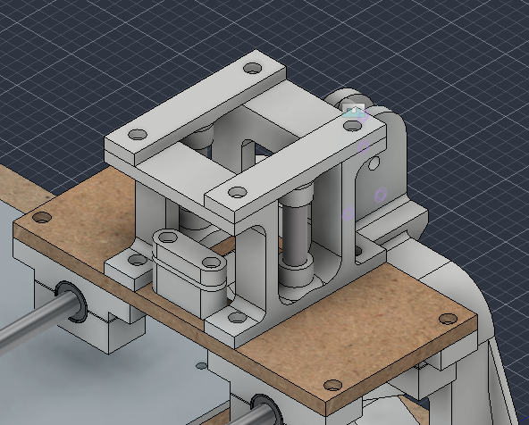
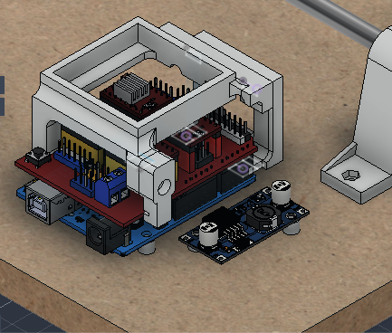

# 2026-11-12 · Session 16 · Pen lift (Z) support drawn, fan box with a screwed leg, Y clamp plates with bigger counterbores

No notebook page.

*Nothing was written in the notebook today. This entry is built from what I said about the day, two Fusion 360 screenshots taken at the end of the night, the parts exported for printing (`Z1`, `EncaixeZ`, `FAN1`, `FAN3` and `Encaixe`) and the Fusion 360 export of the night (design version 57; the export of the 10th was version 55). There are no photos: the machine is still taken apart on the bench.*

## Done
- **Fan box remodelled.** The box printed on the [10th](2026-11-10.md#fan-box) came out stiffer, with the stronger settings of that print (4 walls, 20% infill), and now its legs don't bend to snap over the CNC Shield. So one of the two hooked legs is now a **separate leg (`FAN3`) screwed to the side of the box**. Below.
- **Support of the pen lift (Z) drawn** (`suporteZ`): a frame on the X carriage plate that holds **2 vertical Ø8 rods**, with a cap on each side that closes the top of the rods. The pen carriage that slides on them is not drawn yet. Below.
- **Counterbores of the Y belt clamp plates made bigger** (`Encaixe`, Ø6.0 → Ø6.4), because the screw heads were hard to fit and to line up.
- **X carriage plate:** the 4 counterbores under the feet of the Z support were removed. The screws now have their heads in the feet.
- **New STEP and .f3z exports**, at 23:39.
- **Printing tonight:** the Z support and the new fan box with its leg.
- The machine is still **taken apart**: I didn't get to assemble it today.

## Pen lift (Z) support
It follows the plan of the [10th](2026-11-10.md#pen-lift-z-the-plan): a pen carriage on 2 vertical rods, pushed up and down by the servo.

| Part | Qty | In the model |
|---|---|---|
| Frame (`Z1`) | 1 | 60 × 70 × 50 mm, the full width of the carriage plate (70 mm) and 60 mm across it, in the middle. Two side feet 14 × 70 × 5 mm, each with 2 holes (Ø3.4, Ø6 × 3.3 mm counterbore on top) over the inner holes of the X bearing blocks. On each side, 2 posts 14 × 6 mm, 35 mm apart, and a Ø12 boss with a Ø8 × 10 mm socket for the bottom of a rod. On top, 2 crossbars 60 × 20 × 5 mm, one at each end, with 2 hex nut pockets under each, for the caps. 40.9 cm³ |
| Cap (`EncaixeZ`, `EncaixeZ(Mirror)`) | 2 | 14 × 70 × 5 mm on top of each side, with a Ø12 sleeve under it and a Ø8 × 10 mm socket for the top of the rod. 2 holes Ø3.4 with Ø6 × 3.3 mm counterbores. 5.4 cm³ each |
| Rod (`Haste (1)`) | 2 | Ø8 × 45 mm steel, vertical, 46 mm apart, in the middle of the carriage along the X travel |

- **The X belt passes through the middle**, as I wanted. Inside, the frame is open 32 mm across (the same as the pen opening of the plate) and 40 mm high, from the feet to the crossbars. The 2 X belt clamps (30 mm wide) fit inside the frame with about 1 mm on each side, and the top run of the X belt (about 136 to 138.5 mm above the base) passes between the sides, about 16 mm under the crossbars.
- **Heights** (above the base): the feet sit on the carriage plate at 109.5 mm, the top of the caps is at 164.5 mm, 12.5 mm over the top of the uprights (152 mm). The rods are free between the boss at the bottom (124.5 mm) and the sleeve of the cap (149.5 mm): **25 mm of free rod**. The X motor shaft and the X idler axle are at 131 mm, inside that span. I didn't measure the pen yet, but I think the pen carriage ends up about the height of the pulley.
- **Assembly:** the 4 screws of the feet go first, through the carriage plate into the bearing blocks. Then the rods go into their sockets, and the caps close them from above, with 2 screws each into the nuts under the crossbars.

## The pen carriage, still to draw
What the frame leaves for it, from the model:
- **Travel:** 25 mm of free rod. With one LM8SUU on each rod (16 mm long; 2 spare from the order), about 9 mm of travel is left. The pen only has to lift a few millimetres.
- **The X belt crosses the middle of that span.** Its top run, at about 136 to 138.5 mm above the base, passes between the 2 rods, at the middle of the gantry. A part that joins the 2 bearings has to stay under it (124.5 to 136 mm) or over it (138.5 to 149.5 mm), or go around it.
- **The pen and the belt**, as on the [10th](2026-11-10.md#pen-lift-z-the-plan): a pen right in the middle stands under the top run of the belt, and with the paper at 60.5 mm, it can only be about 70 mm long. A pen about 10 mm to the side of the belt, between the belt and one rod, clears it and still fits in the 32 mm opening of the plate.

## Fan box, with a screwed leg
The box (`FAN1`) has a hooked leg at each corner of its far end, which hold the edges of the CNC Shield. On the box printed on the 10th, those legs were meant to bend a little to snap over the shield. With 4 walls and 20% infill they don't bend any more, so the box doesn't go in.

What changed:
- **One leg was cut off the box** and is now a separate part, `FAN3`: 7 × 25.7 × 11 mm, with the same groove for the edge of the shield. It goes against the outside wall of the box, held by **1 M3 screw** (Ø3.5 hole, Ø6 counterbore on the outside), with 4 more Ø4 holes through the leg and the wall.
- The box is now 1.9 mm longer at that end, for the leg's screw, and a little lighter: 14.9 → 14.3 cm³. The bracket (`FAN2`) is unchanged.
- How it goes on: put the box on with its one fixed leg hooked on the shield, then screw the loose leg on the other side.

**Not finished.** With a single screw, the loose leg can turn a little around it and the box can still wobble from side to side. It was what I could do today. Later it may need two screws on the leg, or a lock on the side so it doesn't bend, and maybe a reprint.

## Y belt clamp plates
The 2 clamp plates (`Encaixe`, 10 × 30 × 6 mm each) press the ends of the Y belt against the belt support under the bed, with 2 screws each from below. Their counterbores went from **Ø6.0 to Ø6.4** (same 3.3 mm depth, same Ø3.4 holes). The screw heads were tight and made the plates hard to move and line up with the support. 1.54 cm³ each.

## X carriage plate
The 4 inner holes of the bearing blocks (23 mm from the middle of the plate) no longer have **counterbores** on top: the feet of the Z support sit over them, and the screw heads are now in the counterbores of the feet. The other 4 holes keep theirs. The plate is still to be made. It's small, so I'll probably 3D print it instead of cutting it on the CNC router.

## The parts exported tonight
From Fusion, for printing: the Z frame and a cap (2 needed), the fan box and its new leg, and the 2 Y clamp plates.

## What changed in the model
Compared with [2026-11-10](2026-11-10.md#what-changed-in-the-model) (design version 55 → 57):
- **Z support** (`suporteZ`), new: the frame `Z1`, the caps `EncaixeZ` and `EncaixeZ(Mirror)`, and the 2 rods `Haste (1)`.
- **Fan box:** `FAN1` changed and the new leg `FAN3` (above).
- **Y clamp plates** (`Encaixe`): counterbores Ø6.4.
- **X carriage plate** (`Mesa_superior`): 4 counterbores removed.
- In this export the **fan box is not on its holes**: the whole `Suporte Fan` is 3.1 mm off along the Arduino and 1.5 mm up, so the bracket's feet float over the board, and a 10 mm fan in the box would go about 0.6 mm into the bed. The parts themselves are right. Only their position in the assembly moved.
- The rest is unchanged. Still not placed: the X idler, the fan and the MG90S servo. `Suporte_Roldana (1)` is still empty.

## Checks on the machine
- **Fan box:** check that the screwed leg holds the box without wobbling, and that the box still clears the bed (about 1 mm over a 10 mm fan, when it sits on the Arduino). Move the bed over it by hand before running the motors.
- **Y belt, lower run:** check that it's in line with the clamp plates printed before, now that the support is 4 mm shorter (from the [10th](2026-11-10.md#checks-on-the-machine)).
- **X belt, upper run:** check that it lines up with the X belt clamp and passes through the Z frame without touching it.
- **Z rods:** cut 2 pieces of Ø8 × 45 mm. Check that they go into the 10 mm sockets, and that the caps close without pushing them.
- **Pen height:** measure the pen and check where it ends up against the pulley and the belt (above).
- From before: `Suporte_Roldana (1)` is still empty, and the bed's counterbores were cut 4.3 mm deep against 3.3 mm in the model.

## Screws for the new parts
From the model.

| Joint | Qty | Screw | Nut |
|---|---|---|---|
| Z frame → carriage plate → X bearing blocks | 4 | M3 × 18 from the top, the head in the counterbore of the foot. That's 5 mm longer than the M3 × 12 of these holes on the 10th, which had their heads in the plate. M3 × 20 still fits, like the M3 × 14 did | Hex pocket under each ear of the bearing block |
| Cap → Z frame | 4 | M3 × 8 from the top, the head in the cap's counterbore | Hex pocket under each crossbar of the frame |
| Fan leg → box | 1 | M3 × 8 from the outside, the head in the leg's counterbore | No nut pocket in the model: a nut inside the box, put in before the fan |
| Y clamp plate → belt support | 4 | M3 × 12 from below, unchanged | Hex pocket on top of the foot |

## Pending
- **Assemble the machine** with the parts printed before and the ones printing tonight (the Z frame and the new fan box).
- **Cut the metal rod** for the Z axis: 2 × Ø8 × 45 mm.
- **Y belt:** check that the lower run lines up with the clamp printed before.
- **X belt:** check that the upper run lines up, then fit the belt with its clamp and spring.
- **X carriage plate:** make it, with the 4 counterbores removed. Probably 3D printed rather than cut on the CNC.
- **Pen carriage:** draw it in Fusion (the bearings on the 2 rods, the holder and the screw for the pen, the servo pushing it), after measuring the pen. Maybe tomorrow.
- **Fan box:** a second screw on the leg or a side lock, if the leg wobbles. Maybe reprint.
- From before: fix the writing sheet with its 4 screws, finish the wiring, take photos of the machine and the bench, save the `$$` output in [firmware/grbl_config.txt](../../firmware/grbl_config.txt), route the cables, fill the misplaced counterbores under the base, and import the standard parts into Fusion at the end.

## Photos
No photos today.

## Fusion 360
CAD exports of this day, at commit eab8293: [STEP](https://github.com/audreifilhorossato/InkHand/blob/eab8293/hardware/cad/Plotter_Pen_InkHand.step) · [Fusion 360 archive (.f3z)](https://github.com/audreifilhorossato/InkHand/blob/eab8293/hardware/cad/Plotter_Pen_InkHand.f3z). The files in `hardware/cad/` now hold the latest export.

## Next step
Assemble the machine with all the printed parts, cut the Z rods and check both belts. Then draw the pen carriage.
