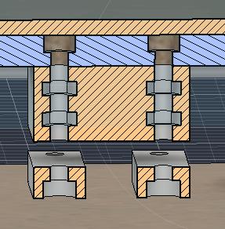
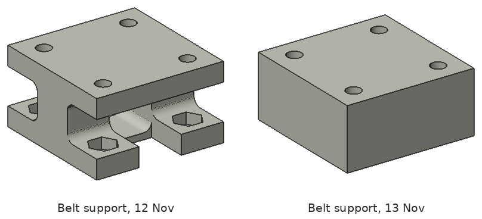
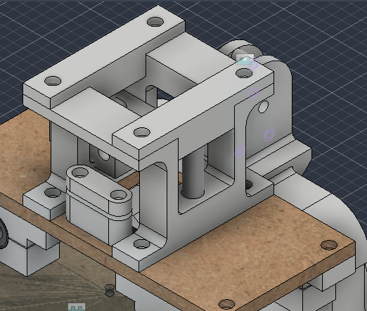
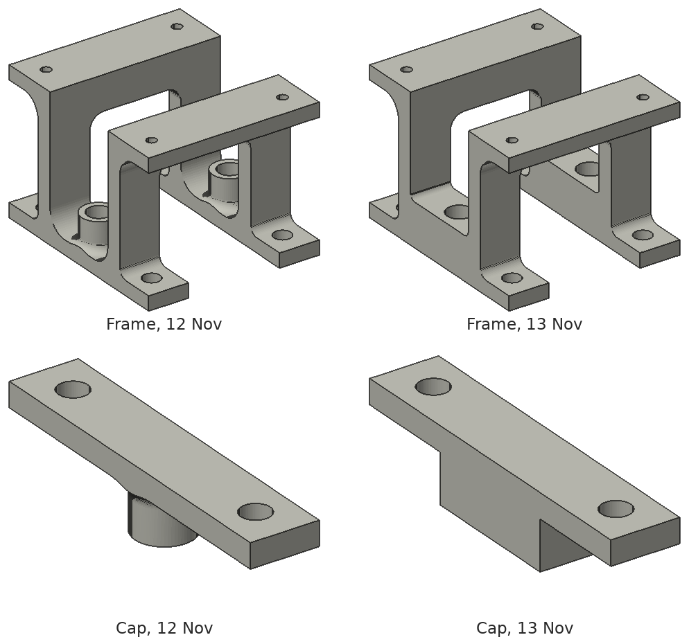
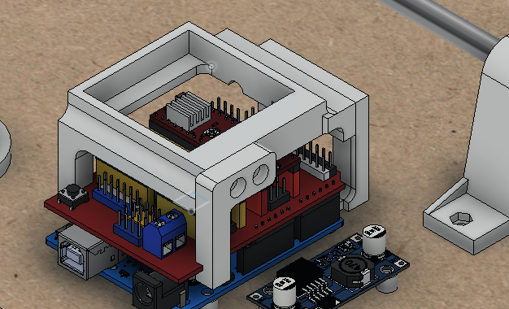
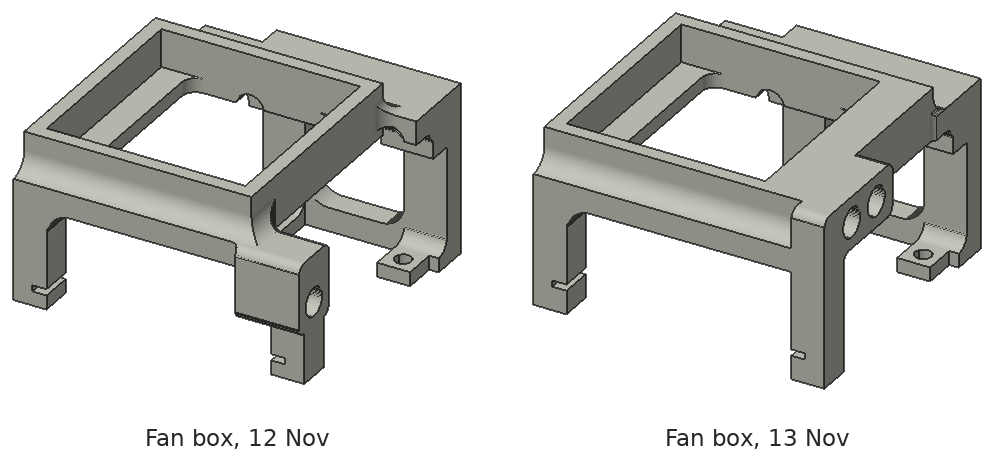
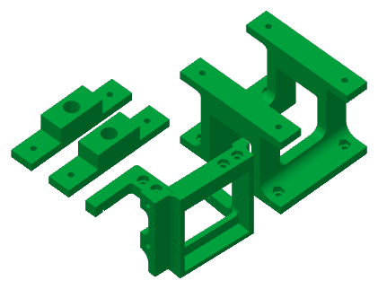
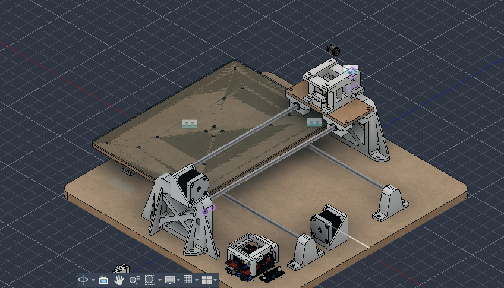

# 2026-11-13 · Session 17 · Yesterday's prints redone: stronger Z support and fan box, Y belt support with the nuts printed in

No notebook page.

*Nothing was written in the notebook today. This entry is built from what I said about the day, four Fusion 360 screenshots, the files exported for printing (three versions of the Y belt support, the fan box, its leg and the Z cap, and the slicer project of the reprint) and the Fusion 360 export of the night (design version 62; the export of the 12th was version 57). There are no photos of the machine today. The before-and-after views in this entry were rendered from the STEP exports of the 12th and the 13th.*

## Done
- **Picked up the parts printed yesterday. All of them came out wrong** (below): the Z support broke when I fitted it, its caps were weak and tight on the rods, the fan box hit the CNC Shield, and the Y belt support printed on the 10th still pulled the belt down.
- **Remodelled all of them:** stronger, with bigger holes for the Z rods (Ø8.0 → Ø8.6).
- **Y belt support redone with its nuts printed in.** The nuts under the bed were awful to fit, so now they go inside the part: the printer stops, I drop the nuts into their pockets, and it prints over them. Printed on a separate printer, about an hour. Below.
- **Y belt fitted again** with the new support, the clamp plates and the tension springs, and **the tension adjusted**. It came out exactly the right size and holds the belt well. Really happy with it.
- **Reprint sent** of the Z frame, its 2 caps, the fan box and its leg, on the X1 Carbon.
- **Z rods cut** from the steel rod, and their ends ground flat and square on the bench grinder.
- **Wiring:** connected more of the motor wires and ran them up along the upright, held with double-sided tape. I should have planned a path for them in the model and didn't, but it came out tidy: it doesn't get in the way and looks good.
- **New STEP and .f3z exports**, at 22:46.

## Problems → fixes

| Part | What went wrong | Fix (in the model) |
|---|---|---|
| Z frame (`Z1`) | Too weak: it broke when I fitted it. The rods didn't go into their sockets | Solid base on each side around the rod socket. Sockets Ø8.0 → Ø8.6. 40.9 → 45.9 cm³ |
| Caps (`EncaixeZ`, `EncaixeZ(Mirror)`) | Too weak, and tight on the rods | A solid block under the cap instead of the round sleeve. Socket Ø8.0 → Ø8.6. 5.4 → 8.2 cm³ each |
| Fan box (`FAN1`, `FAN3`) | The seat of the side screw hit the CNC Shield, and the box was weak | A longer leg with 2 screws and their nuts, a thicker wall where it's screwed on, and the box put back on the Arduino holes. 14.3 → 16.8 cm³ (box), 1.5 → 2.8 cm³ (leg) |
| Y belt support (`Suporte_correia`, printed on the 10th) | Still too tall: the belt bent down to the clamp. The nuts were awful to hold while screwing | A solid block, 3 mm shorter, with its 8 nuts printed in. 8.0 → 12.1 cm³ |

I made the holes a little bigger in the model, "both for the rod and for the screw". In the export, the rod sockets went from Ø8.0 to Ø8.6, and the counterbores of the fan leg from Ø6.0 to Ø6.2. The screw holes of the Z frame, the caps and the belt support are still Ø3.4.

## Y belt support, with the nuts printed in

The support of the [10th](2026-11-10.md#y-belt-support-4-mm-shorter) was a plate under the bed, 2 posts and 2 feet, with the nuts in open pockets. The new one is **a solid block, 30 × 30 × 14.5 mm**, under the middle of the bed:

- **4 holes** Ø3.4, the same as before (20 mm apart), right through the block.
- **2 nut pockets on each hole**, closed inside the block: hex 5.7 mm across flats, 2.6 mm deep, for M3 nuts (2.4 mm). The lower row holds the nuts of the clamp plates' screws, which come from below. The upper row holds the nuts of the bed's screws, which come from the top. Between them, 3.3 mm of plain hole.
- **From either face:** 3 mm of hole, a nut pocket (3.0 to 5.6 mm), 3.3 mm of hole, a nut pocket (8.9 to 11.5 mm), 3 mm of hole. The block is symmetric, so it prints the same either way up.
- **How it's printed:** the printer pauses when the first row of pockets is finished (5.6 mm from the plate), I put in the 4 nuts, and it prints over them. Then the same again at 11.5 mm. 8 nuts in all.

**Height, and the belt line.** The block reaches from the bed (51.5 mm above the base) down to **37.0 mm**, where the belt is clamped. On the pulleys, the back of the Y belt is at about 36.7 mm. So the clamp is now **about 0.3 mm over the belt line**, against 2.7 mm under it on the 10th (and about 6.7 mm under on the 6th). That matches what I saw on the machine, where the belt now sits well in the clamp. The block is 3 mm shorter, a little more than the 2.5 mm I thought the posts could still lose on the 10th.

**The lower run of the belt** now passes about 5 mm under the clamp plates (it was 1.4 to 2 mm).

**Three versions** of the block were exported today:

| File | The holes and the nuts |
|---|---|
| `Suporte_correia66` | One 5.2 mm pocket for 2 nuts in the middle, and the hole open on one face only |
| `Suporte_correia77` | The hole open on both faces, and one long hex channel (9.2 mm) between them |
| `Suporte_correia88` | 2 separate nut pockets on each hole. **This is the one in the model** |

**In the model,** the 2 clamp plates (`Encaixe`) are still at their old height, now 5 mm under the block instead of 2 mm. On the machine they press the belt against it.

## Z support, stronger

The frame and the caps keep their outside sizes. What changed:

- **Frame (`Z1`):** on the 12th, the bottom of each rod stood in a Ø12 boss on the 5 mm foot, on its own between the 2 posts. Now the bottom of each side is **a solid block, 14 × 41 × 10 mm**, that joins the 2 posts and holds the rod socket (Ø8.6 × 10 mm), with R2 fillets where it meets the posts. The posts, the feet and the crossbars are the same.
- **Caps (`EncaixeZ`, `EncaixeZ(Mirror)`):** the Ø12 sleeve under the cap is now **a block, 14 × 29 × 10 mm**, that goes between the 2 posts of the frame and holds the top of the rod (Ø8.6 × 10 mm socket). The plate on top and its 2 counterbored holes are the same.
- **Rods:** still 2 × Ø8 × 45 mm, 10 mm in each socket. The free length between the frame and the cap is still **25 mm** (124.5 to 149.5 mm above the base).

## A bearing block on the Z rod
Also new in the model: **a bearing block for the pen carriage** (`suporteZ / Carrinho (1)`), on the left Z rod. It's the bearing block of the bed (`Carrinho`) without its ears, turned upright: 34 × 25 × 17 mm in 2 halves (`Parte Alta (2)` 12 mm, `Parte Baixa (2)` 12.5 mm, 0.5 mm apart), a Ø15 bore for one LM8SUU along the rod, and 2 M3 screws through both halves. There's a 9th LM8SUU in the model too, still loose.

It isn't placed exactly yet: it's about 1 mm off the rod's axis, and its bottom is 2.1 mm into the solid base of the frame. Sitting on the base, it would take 17 of the 25 mm of free rod, leaving **about 8 mm of travel**.

It stays clear of the X belt: its inside face is about 4 mm from the edge of the belt, which still passes between the 2 rods. The part that will join the 2 bearings and hold the pen isn't drawn yet, so the question of the [12th](2026-11-12.md#the-pen-carriage-still-to-draw) is still open: it has to pass under the top run of the belt (about 136 to 138.5 mm above the base) or over it.

## Fan box

- **The leg (`FAN3`)** is now 7 × 35.7 × 25 mm, against 7 × 25.7 × 11 mm on the 12th: it runs 25 mm along the side of the box from the hook, and it's held by **2 M3 screws, 9 mm apart** (Ø3.5 holes, Ø6.2 counterbores on the outside), instead of one. That's the fix for the wobble I expected on the [12th](2026-11-12.md#fan-box-with-a-screwed-leg).
- **The box (`FAN1`)**: the side wall where the leg screws on is now 9.5 mm thick, with **a nut pocket for each screw** on its outside face, under the leg. On the 12th there was no pocket. The box is also 2 mm shorter at the end with the hooks.
- **Both hooks** (the one on the box and the one on the leg) have a thicker lip under the board: 5 mm instead of 3 mm.
- **The bracket (`FAN2`)** is unchanged.
- **Placed on its holes.** On the 12th the whole fan box was 3.1 mm off along the Arduino and 1.5 mm up. Now the bracket's holes are on the Arduino's holes and its feet sit on the board. With a 10 mm fan in the box, there's **about 0.9 mm** between the fan and the bed, and 2.9 mm between the rim of the box and the bed, as planned on the [10th](2026-11-10.md#fan-box).

## The reprint
On one plate in the slicer, on the X1 Carbon: the Z frame (on its side), the 2 caps, the fan box and its leg. The same settings as the plate of the [10th](2026-11-10.md#the-print-of-the-evening), on another printer and with less infill:

| Setting | This plate |
|---|---|
| Printer | Bambu Lab X1 Carbon, 0.4 mm nozzle |
| Material | Bambu PLA Basic, green |
| Layer height | 0.08 mm |
| Walls | 4 |
| Infill | 15%, 3D honeycomb (20% on the 10th) |
| Top / bottom shell layers | 7 / 7 |
| Supports | On (normal, auto) |
| Brim | 20 mm, outside and inside |
| X-Y hole compensation | 0 |

The belt support was printed apart, on another printer, so I could be there for the pauses.

## What changed in the model
Compared with [2026-11-12](2026-11-12.md#what-changed-in-the-model) (design version 57 → 62):
- **Z frame** (`Z1`): solid base on each side, sockets Ø8.6.
- **Caps** (`EncaixeZ`, `EncaixeZ(Mirror)`): a block instead of the sleeve, sockets Ø8.6.
- **Pen carriage**, started: a bearing block `Carrinho (1)` on the left Z rod, and a 9th LM8SUU, loose.
- **Fan box:** `FAN1` and `FAN3` changed (above), and the whole `Suporte Fan` moved 3.1 mm along the Arduino and 1.5 mm down, onto its holes. `FAN2` only moved.
- **Y belt support** (`Suporte_correia`): the solid block with the nuts inside.
- The rest is unchanged, including the clamp plates (`Encaixe`), the X carriage plate and the X belt clamp. Still not placed: the X idler, the fan and the MG90S servo. `Suporte_Roldana (1)` is still empty.

## Checks on the machine
- **Caps in the frame:** the block under each cap is 29 mm wide, and the gap between the posts is 29 mm too, with no clearance in the model. If a cap doesn't go in, sand its sides, or make the block about 0.4 mm narrower and reprint.
- **Fan box hooks:** the groove of each hooked leg is 1.3 mm high, and the CNC Shield's board is 1.6 mm. With the bracket on the Arduino, the lip under the board goes 0.3 mm into it in the model. If the hooks don't slide on, open the groove to about 1.8 mm.
- **Z rods:** the model needs 45 mm (10 mm in each socket and 25 mm free). Check both rods. I don't remember if I cut 40 or 45 mm.
- **Z bearing block:** put it on the rod's axis and on top of the frame's base before drawing the rest of the pen carriage.
- **Fan box and bed:** about 0.9 mm between a 10 mm fan and the bed. Move the bed over the box by hand before running the motors.
- **X belt, upper run:** check that it lines up with the X belt clamp and passes through the Z frame without touching it.
- From before: `Suporte_Roldana (1)` is still empty, and the bed's counterbores were cut 4.3 mm deep against 3.3 mm in the model.

## Screws for the new parts
From the model.

| Joint | Qty | Screw | Nut |
|---|---|---|---|
| Bed → belt support | 4 | M3 × 8 from the top of the bed, unchanged | Printed into the block, upper row |
| Clamp plate → belt support | 4 | M3 × 12 from below (M3 × 10 also goes through the nut). **Not the M3 × 14** fitted before: its tip would meet the bed screw inside the block | Printed into the block, lower row |
| Fan leg → box | 2 | M3 × 8 from the outside, the head in the leg's counterbore (M3 × 10 also fits) | Hex pocket on the outside of the box wall, under the leg: put the nuts in before the leg |
| Z frame → carriage plate → X bearing blocks | 4 | M3 × 18 from the top, the head in the counterbore of the foot. The feet didn't change, so this is still the [12th](2026-11-12.md#screws-for-the-new-parts)'s length: M3 × 16 only just reaches through the nut, M3 × 20 also fits | Hex pocket under each ear of the bearing block |
| Cap → Z frame | 4 | M3 × 8 from the top, unchanged | Hex pocket under each crossbar of the frame |

## Pending
- **Assemble the Z support and the fan box** when the reprint is done: check the rods in the Ø8.6 sockets, the caps between the posts and the hooks of the fan box (above).
- **Fix the writing sheet** with its 4 screws.
- **X carriage plate:** make it, probably 3D printed.
- **X belt:** fit it with its clamp and spring, and check that the upper run lines up.
- **Pen carriage:** place the bearing block on the rod, measure the pen, then draw the rest: a second block, the part that joins them around the X belt, the pen holder and the servo.
- **Cables:** plan a path for them in the model next time, instead of taping them on afterwards.
- From before: finish the wiring, take photos of the machine and the bench, save the `$$` output in [firmware/grbl_config.txt](../../firmware/grbl_config.txt), fill the misplaced counterbores under the base, and import the standard parts into Fusion at the end.

## Photos
No photos of the machine today. The images in this entry are Fusion 360 screenshots, the slicer plate and views rendered from the STEP exports.

## Fusion 360
CAD exports: [STEP](../../hardware/cad/Plotter_Pen_InkHand.step) · [Fusion 360 archive (.f3z)](../../hardware/cad/Plotter_Pen_InkHand.f3z)

## Next step
Assemble the reprinted Z support and fan box, screw on the writing sheet and fit the X belt. Then draw the rest of the pen carriage.
